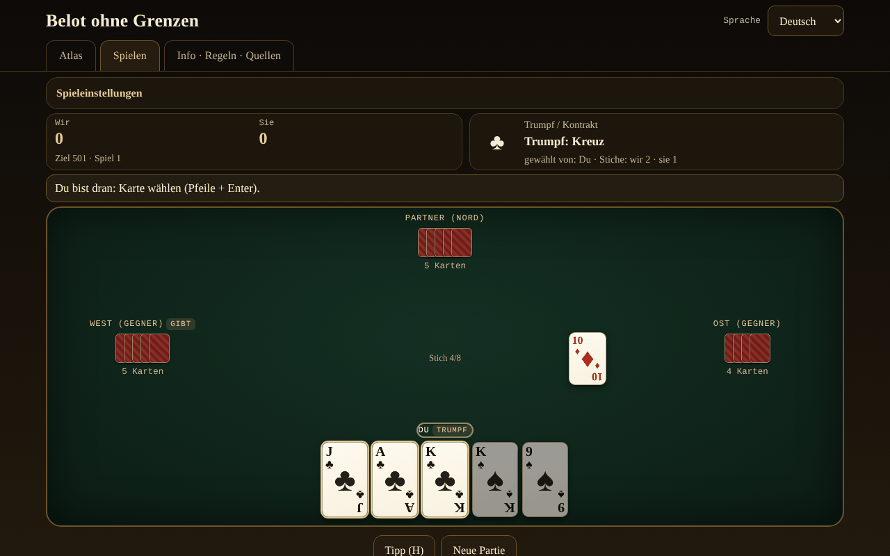

# Belot fără frontiere

[English](README.md) · [Română](README.ro.md) · [Français](README.fr.md) · [Italiano](README.it.md) · [Español](README.es.md) · [Português](README.pt.md) · **Deutsch** · [Magyar](README.hu.md)

**Version:** 1.2.7 · **Zuletzt aktualisiert:** 2026-10-26

Oberflächensprachen: **Română, English, Français, Italiano, Español, Português (PT), Deutsch, Magyar**

Atlas und Spiel gegen eine lokale KI: das rumänische Belot und seine Verwandten (Belote, Contrée, Bela, Klaverjas, Jass), in einer einzigen HTML-Datei, offline.

**Online-Anwendung:** https://chiuta.github.io/Belot-fara-frontiere/

## Was es ist

Ein Atlas der Belote-/Bela-/Klaverjas-/Jass-Familie und ein Spiel: du und ein KI-Partner gegen zwei KI-Gegner, am Tisch mit 4 Spielern. Priorität 1 ist das rumänische Belot (32 Karten, Trumpf in zwei Runden gewählt, Ansagen, Pflicht zum Bedienen/Stechen/Übertrumpfen, Capot, Spiel bis 501/1001). Die anderen Varianten laufen auf derselben parametrisierten Engine. Alles ist eine einzige `index.html` (~200 KB), ohne Abhängigkeiten, ohne externe Schriftarten oder Bilder, ohne Konto, ohne Telemetrie. Die Karten sind in CSS gezeichnet.

## Funktionen

Im Code und in Tests geprüft:

- **7 spielbare Varianten** (Tabelle unten) auf einer parametrisierten Engine (Reizen, Pflichten, Wertung, konfigurierbare Ansagen) und **5 reine Atlas-Einträge**.
- **Rumänisches Belot**: Trumpfwerte B 20, 9 14, A 11, 10 10, K 4, D 3, 8/7 = 0; Nicht-Trumpf A 11, 10 10, K 4, D 3, B 2; Trumpf in zwei Runden nach der aufgedeckten Karte (der Geber kann in Runde 2 gezwungen werden, optional); Ansagen terță 20 / cincizeci 50 / sută 100 / careu (B 200, 9 150, A-10-K-D 100) / belot 20; letzter Stich +10 (Summe 162); Capot +90; die Regel „la jumătate“/Fall ist im Blatt dokumentiert; Ziel 501 oder 1001.
- **Pflichten** zum Bedienen, Stechen und Übertrumpfen (außer für den gewinnenden Partner, wo die Regel der Variante es erlaubt); unzulässige Karten werden abgedunkelt, und der Versuch, sie zu spielen, zeigt den Grund.
- **Ansagen** werden automatisch erkannt (erschöpfende Suche nach der besten Aufteilung in Folgen und Vierlinge), Wettstreit zwischen den Teams (Gleichstand = Aufhebung in RO — optional Rotation —, Rotation in den anderen), das Team ohne Stiche verliert die Ansagen (das Belot bleibt).
- **KI mit 3 echten Stufen**: 0 zufällig legal; 1 heuristisch (Schätzung des Trumpfs aus der Hand durch Simulationen, Trumpfzählen, Partnerspiel); 2 PIMC-Suche (Monte-Carlo-Simulationen auf „Welten“, die mit dem Gesehenen vereinbar sind). Die KI **hat keinen Zugriff auf die verdeckten Hände** (sie erhält nur die Sicht des Spielers); Ausnahme: die ausdrückliche Option „Lernmodus“, die **dir** die Hände zeigt — die KI nutzt sie trotzdem nicht.
- **Belot (K+D von Trumpf)**: Beim rumänischen Belot wird es nur bei der zweiten Karte angesagt (die KI folgert nichts aus der ersten Karte); bei den anderen Varianten bei der ersten, wie bei Pagat.
- **Hinweis** (H): Die KI der Stufe 2 schlägt dir eine Karte oder ein Gebot vor.
- **Punktblatt**: Nach der zweiten Hand zeigt das Ergebnisfenster die Tabelle aller Hände des Spiels (hinzugefügte Punkte → Summe), in den 8 Sprachen.
- **Mischen** mit `crypto.getRandomValues` und Rejection Sampling; **optionaler Seed** (mulberry32) für reproduzierbare Kartenverteilungen.
- **Atlas** durchsuchbar und filterbar (spielbar/nur Atlas, Familie), mit Blättern: Regeln, regionale Unterschiede, ⚠ Näherungen, Quellen.
- **Oberfläche in 8 Sprachen** (RO/EN/FR/IT/ES/PT/DE/HU), mit automatischer Erkennung und Auswahl. Die langen Texte (die Atlasblätter, der Abschnitt Über) sind auf Rumänisch und Englisch vollständig; in FR/IT/ES/PT/DE/HU wird die englische Fassung mit einem dezenten Hinweis „Text auf Englisch“ angezeigt.
- **Barrierefreiheit**: vollständig per Tastatur spielbar (Pfeile + Enter/Leertaste, H für den Hinweis), `aria-live` für den Spielzustand, sichtbarer Fokus, Touch-Ziele von mindestens 44 px, `prefers-reduced-motion`, ein Modus mit unterscheidbaren Farben bei Farbenblindheit (♦ blau, ♣ grün), kein horizontales Scrollen bei 390 px.
- Lokale Statistiken (gespielte/gewonnene Spiele) und Einstellungen (Sprache, Stufe, Farben) in `localStorage`, in `try/catch`-Blöcken; die Anwendung funktioniert auch ohne sie.

## Varianten

| Name | Spielbar? | ⚠ Näherungen |
|---|---|---|
| Rumänisches Belot | ja | ⚠ Es gibt kein offizielles Regelwerk: „la jumătate“/Fall ist eine Entscheidung des Autors (Fall ⇒ die Gegner nehmen alles, das Belot bleibt; Gleichstand = hat gehalten). Keine „bile“ (exakte Punkte), kein Tausch der 7, kein Bizon. Die aufgedeckte Karte geht immer an den, der den Trumpf wählt. Ansagen (terță/cincizeci/sută/careu) nur bei der ersten Karte; das Belot wird nur bei der zweiten Karte angesagt. Zwei zwischen den Quellen strittige Punkte sind Optionen unter „Spieleinstellungen“: Stechpflicht auch über den Partner (belot.md) vs. befreit (Pagat; standardmäßig befreit) und gleiche Ansagen aufgehoben (belot.md; Standard) vs. der Erste in der Rotation (Pagat). |
| Klassische Belote (Frankreich) | ja | ⚠ Der Gleichstand 81–81 wendet kein „litige“ an; die Punkte werden exakt geführt. |
| Belote contrée (Coinche) | ja | ⚠ Die Folgen-/Vierlingsansagen sind standardmäßig deaktiviert (optional, mit den Regeln der klassischen Belote); kein „sans atout/tout atout“; gefallener Capot 500 (Entscheidung). |
| Bela (Kroatien/Serbien) | ja | ⚠ Nur das Grundspiel mit 6 Karten zu 4 Spielern; keine „otvorena bela“; exakte Punkte statt des regionalen Punktblatts. |
| Klaverjas Amsterdams | ja | ⚠ Vereinfachtes Reizen (der Erste, der nicht passt, wählt den Trumpf, der Letzte ist gezwungen); kein „verzaakt“, keine Turnierwertung. |
| Klaverjas Rotterdams | ja | ⚠ Dieselben Näherungen wie bei Amsterdams. |
| Jass (Schieber, Schweiz) | ja | ⚠ Französische statt Schweizer Karten; Farbmultiplikatoren (♠ ♦ ×2) und Ziel 1500 dokumentiert gewählt; vereinfachtes Weis (nur ein Team zählt seine Weis; der Vierling von 100 schlägt die Folge von 100, und völliger Gleichstand geht nach Rotation — in einer Quelle nicht bestätigt); Une-ufe mit 6 = 0 und Ass = 11 (andere Tische: 6 = 11, Ass = 0); kein Differenzler/Coiffeur. |
| Bulgarisches Belot | nur Atlas | ⚠ Die Kontrakte „ohne Trumpf“/„alles Trumpf“ sind nicht in der Engine. |
| Belot zu zweit / zu dritt | nur Atlas | ⚠ Die Engine ist auf 4 Spieler in Partnerschaft aufgebaut. |
| Baloot | nur Atlas | ⚠ Nicht implementiert. |
| Clobyosh / Klabberjass | nur Atlas | ⚠ Nicht implementiert. |
| Coiffeur (Jass) | nur Atlas | ⚠ Hat keine Kontrakttabelle. |

## Bedienungsanleitung

1. Öffne `index.html` (oder die Online-Seite). Im Tab **Atlas** liest du die Blätter der Varianten; ⚠ kennzeichnet die Näherungen.
2. Drücke **▶ Spielen** auf einem Blatt oder wechsle in den Tab **Spielen** und wähle die Variante unter „Spieleinstellungen“ (Ziel, KI-Stufe, Ansagen, Seed, Lernmodus, unterscheidbare Farben).
3. Der Geber rotiert. Beim Reizen zeigt dir das obere Feld die Optionen: „Ich nehme“ oder „Passe“ (Runde 1), dann eine Farbe oder „Passe“ (Runde 2); bei der Contrée wählst du Farbe und Wert, dann kannst du Contra/Re geben; beim Jass wählst du Trumpf, Obe-abe, Une-ufe oder „Schieben“.
4. Im Spiel sind die goldenen Karten die zulässigen, die abgedunkelten sind verboten. Klicken oder Pfeile und Enter/Leertaste zum Spielen. Hast du Ansagen, hake „Ansage“ vor der ersten Karte an.
5. Drücke **Hinweis (H)** für einen Rat der starken KI.
6. Am Ende der Hand erscheint die Punktetabelle; **Nächste Hand** setzt fort, und wenn das Ziel erreicht ist, endet das Spiel. **Neues Spiel** setzt zurück.
7. Die Sprache wird über die Auswahl oben rechts geändert; sie wird im Browser gemerkt.

## Datenschutz und Netzwerk

- Kein Netzwerk: Es gibt kein `fetch`, kein `XMLHttpRequest`, kein `WebSocket` und keine externen Ressourcen; CSP `default-src 'none'` ohne `connect-src`; Skripte laufen nur auf Grundlage der beim Build berechneten sha256-Hashes; `style-src 'unsafe-inline'` ist für die Stile auf der Seite nötig.
- Keine Telemetrie, kein Konto, keine Cookies. In `localStorage` werden nur Sprache, KI-Stufe, unterscheidbare Farben, Variante und lokale Statistiken gespeichert.
- Die einzigen externen Links sind die in der Ecke der Seite (Buy Me a Coffee), mit `rel="noopener"`; sie öffnen sich nur beim Klicken.

## Grenzen und Hinweise

- Belot hat kein einheitliches Regelwerk: Die hier gewählten Regeln sind auf jedem Blatt dokumentiert; an Tischen in Rumänien weichen sie ab (Bile, „la jumătate“, Bizon, Tausch der 7).
- Die Regeln wurden über öffentliche Seiten (Pagat, belot.md, belot.bg, Wikipedia) geprüft, die durch automatische Zusammenfassungen gelesen wurden, nicht aus gedruckten Regelwerken; regionale Nuancen können falsch zusammengefasst sein. Der Begriff „24“ für den Capot ließ sich in keiner Quelle prüfen und wird nicht verwendet.
- Die KI ist ehrlich (sie sieht die verdeckten Karten nicht), aber keine Expertin: Stufe 2 ist ein guter Tischspieler; beim Reizen nutzt sie kurze Simulationen; sie modelliert die Gegner mit ihrer eigenen Heuristik und zieht daher möglicherweise das Abwarten vor, wo ein Mensch die Trümpfe ziehen würde.
- Es ist kein Glücksspiel mit Einsatz: kein Geld, keine Preise, keine Konten.
- MIT-Lizenz (siehe unten).

## Quellen

- Pagat.com: Belote, Coinche, Contrée, Bela, Belot, Klaverjassen, Schieber, Baloot — `https://www.pagat.com/jass/belote.html`, `/coinche.html`, `/contree.html`, `/bela.html`, `/belot.html`, `/klaverjassen.html`, `/schieber.html`, `/baloot.html`
- Belot.md: https://belot.md/reguli_new.php
- belot.bg: https://belot.bg/en/rules-belot/
- Wikipedia: https://ro.wikipedia.org/wiki/Belot · https://en.wikipedia.org/wiki/Belot · https://fr.wikipedia.org/wiki/Belote_contr%C3%A9e · https://hr.wikipedia.org/wiki/Belot · https://en.wikipedia.org/wiki/Klaverjas
- regles-du-jeu.net: https://www.regles-du-jeu.net/comment-compter-les-points-a-la-belote/

In der Anwendung vermerkte regionale Unterschiede: belot.md verwendet Bile und die Regeln Bizon/Tausch der 7; Pagat setzt den Kontrakt der Belote bei über 81 an und behandelt 81–81 als „litige“; der gefallene Capot bei der Contrée beträgt je nach Quelle 500 oder 410.

## Lokal ausführen

Lade `index.html` herunter und öffne die Datei im Browser; sie funktioniert vollständig ohne Internet. Kein Server, keine Installation.

## Verlauf / Changelog

### 1.2.5 — 2026-10-22
- fff-kit 1.1.4: Touch-Ziele und Mindestschriftgröße

### 1.2.4 — 2026-10-22
- fff-kit 1.1.2: PBKDF2 mit 600.000 Iterationen, Schutz vor Clickjacking

### 1.2.3 — 2026-10-22

Feinschliff für Mobilgeräte und Barrierefreiheit: Text mit mindestens 12 px und Touch-Ziele von mindestens 24 px. das technische Etikett listet jetzt alle 8 Oberflächensprachen; sichtbarer Tastaturfokus bei jedem Steuerelement.

### 1.1.0 — 2026-10-14
- Datensicherung und Datenkennzeichnung (fff-kit).

### 1.0.0 — 12. Oktober 2026
- Die Version und das Datum der letzten Aktualisierung werden in der Anwendung angezeigt (Fußzeile).

### 11.10.2026 (dritte Aktualisierung) — 11. Oktober 2026
- Das Punktblatt des Spiels im Ergebnisfenster (hinzugefügte Punkte und Summe je Hand), in den 7 Sprachen.
- Die Ergebnistabelle der Hand hatte eine leere Spaltenüberschrift (von axe gemeldet, wenn das Fenster geöffnet ist); jetzt hat sie eine (visuell verborgene) Beschriftung.
- Freier Platz unter dem Inhalt, damit das feste Widget „Unterstützen“ die letzten Schaltflächen nicht mehr verdecken kann; CSP: `connect-src 'none'`.

### 11.10.2026 (zweite Aktualisierung) — 11. Oktober 2026
- Die Kurzlabels auf den Atlaskarten (z. B. „4 Spieler“, „32 Karten“, „Trumpf in 2 Runden“, „Reizen“) wurden in jeder Sprache auf Rumänisch angezeigt; jetzt sind sie in die 7 Oberflächensprachen übersetzt, und die Atlassuche findet sie auch in der gewählten Sprache.
- Mobil (≤620 px): Die Tabs (Atlas, Spielen, Über) passen in eine Zeile, die Kopfzeile braucht weniger Platz.

### 11.10.2026 — 11. Oktober 2026
- Barrierefreiheit: Überschriften der Ebene 2 (visuell verborgen) für jeden Tab, der Block „Unterstützen“ als beschriftete Region (aside); axe-Prüfung ohne Verstöße bei beiden Größen.

## Lizenz

MIT — siehe Datei `LICENSE`.

## Autor

Alexio — Alexandru-Ionuț Chiuță, alexio@trom.tf

## Zusammenfassung

Belot ohne Grenzen ist ein Atlas und Spiel in einer einzigen Datei, offline, der Belote-Familie: das rumänische Belot (Priorität), die klassische französische Belote, die Belote contrée, Bela, Klaverjas (Amsterdam und Rotterdam) und Jass (Schieber) sind gegen eine KI spielbar, die nie verdeckte Hände sieht; fünf weitere Verwandte sind nur im Atlas. Jede Näherung ist mit ⚠ gekennzeichnet. Oberfläche in 8 Sprachen (lange Texte nur auf Rumänisch und Englisch), per Tastatur spielbar, Option für Farbenblinde, kein Netzwerk, keine Telemetrie, kein Konto. Lizenz: nicht erklärt (Entscheidung des Autors).
