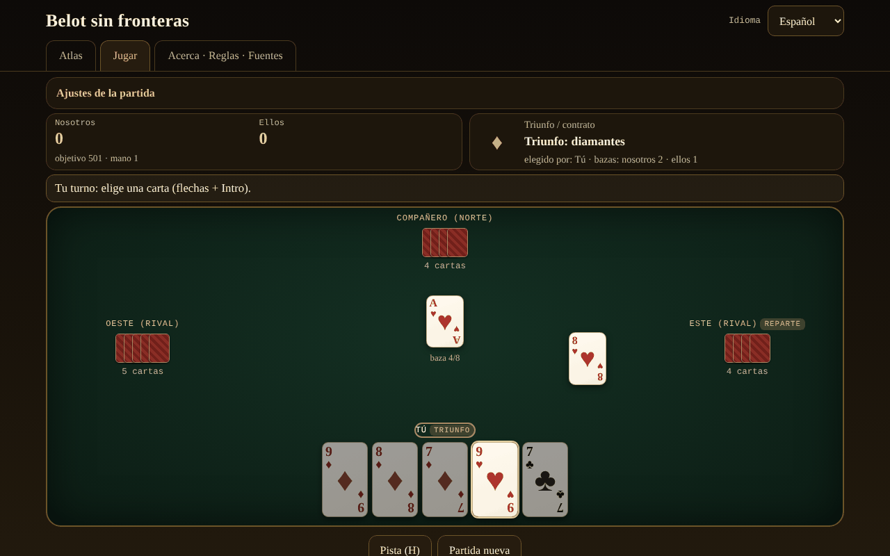

# Belot fără frontiere

[English](README.md) · [Română](README.ro.md) · [Français](README.fr.md) · [Italiano](README.it.md) · **Español** · [Português](README.pt.md) · [Deutsch](README.de.md) · [Magyar](README.hu.md)

**Versión:** 2.2.0 · **Última actualización:** 2026-10-27

Idiomas de la interfaz: **Română, English, Français, Italiano, Español, Português (PT), Deutsch, Magyar**

Atlas y juego contra una IA local: el belot rumano y sus parientes (belote, contrée, bela, klaverjas, jass), en un único archivo HTML, sin conexión.

**Aplicación en línea:** https://chiuta.github.io/Belot-fara-frontiere/

## Qué es

Un atlas de la familia belote/bela/klaverjas/jass y un juego: tú y un compañero IA contra dos adversarios IA, en una mesa de 4 jugadores. La prioridad 1 es el belot rumano (32 cartas, triunfo elegido en dos vueltas, anuncios, obligación de servir/fallar/sobrefallar, capot, juego hasta 501/1001). Las demás variantes funcionan con el mismo motor parametrizado. Todo es un único `index.html` (~200 KB), sin dependencias, sin fuentes ni imágenes externas, sin cuenta, sin telemetría. Las cartas están dibujadas en CSS.

## Funciones

Verificado en el código y en las pruebas:

- **7 variantes jugables** (tabla más abajo) sobre un motor parametrizado (subasta, obligaciones, puntuación, anuncios configurables) y **5 entradas solo de atlas**.
- **Belot rumano**: valores del triunfo J 20, 9 14, A 11, 10 10, K 4, Q 3, 8/7 = 0; fuera de triunfo A 11, 10 10, K 4, Q 3, J 2; triunfo en dos vueltas tras la carta vuelta (el repartidor puede verse obligado en la vuelta 2, opcional); anuncios terță 20 / cincizeci 50 / sută 100 / careu (J 200, 9 150, A-10-K-Q 100) / belot 20; última baza +10 (total 162); capot +90; la regla «la jumătate»/caída documentada en la ficha; objetivo 501 o 1001.
- **Obligaciones** de servir, fallar y sobrefallar (salvo para el compañero que gana, donde la regla de la variante lo permite); las cartas ilegales aparecen atenuadas, y el intento de jugarlas muestra el motivo.
- **Anuncios** detectados automáticamente (búsqueda exhaustiva de la mejor división en secuencias y cuartetos), concurso entre equipos (empate = anulación en RO — opcionalmente rotación —, rotación en las demás), el equipo sin bazas pierde los anuncios (el belot permanece).
- **IA con 3 niveles reales**: 0 aleatorio legal; 1 heurístico (estimación del triunfo a partir de la mano mediante simulaciones, recuento de triunfos, juego de compañero); 2 búsqueda PIMC (simulaciones Monte Carlo sobre «mundos» compatibles con lo que ha visto). La IA **no tiene acceso a las manos ocultas** (recibe solo la vista del jugador); excepción: la opción explícita «Modo aprendizaje», que **te muestra** las manos — la IA sigue sin usarlas.
- **Belot (K+Q de triunfo)**: en el belot rumano se anuncia solo con la segunda carta (la IA no deduce nada de la primera carta); en las demás variantes, con la primera, como en Pagat.
- **Sugerencia** (H): la IA de nivel 2 te propone una carta o una puja.
- **Hoja de puntuación**: tras la segunda mano, la ventana de resultado muestra la tabla de todas las manos de la partida (puntos añadidos → total), en los 8 idiomas.
- **Barajado** con `crypto.getRandomValues` y muestreo por rechazo; **semilla opcional** (mulberry32) para repartos reproducibles.
- **Atlas** con búsqueda y filtros (jugables/solo atlas, familia), con fichas: reglas, diferencias regionales, aproximaciones ⚠, fuentes.
- **Interfaz en 8 idiomas** (RO/EN/FR/IT/ES/PT/DE/HU), con autodetección y selector. Los textos largos (las fichas del atlas, la sección Acerca de) están completos en rumano e inglés; en FR/IT/ES/PT/DE/HU se muestra la versión en inglés con una discreta nota «texto en inglés».
- **Accesibilidad**: juego completo con teclado (flechas + Intro/Espacio, H para la sugerencia), `aria-live` para el estado del juego, foco visible, áreas táctiles de al menos 44 px, `prefers-reduced-motion`, modo de colores distintos para el daltonismo (♦ azul, ♣ verde), sin desplazamiento horizontal a 390 px.
- Estadísticas locales (partidas jugadas/ganadas) y preferencias (idioma, nivel, colores) en `localStorage`, en bloques `try/catch`; la aplicación funciona también sin ellos.

## Variantes

| Nombre | ¿Jugable? | ⚠ Aproximaciones |
|---|---|---|
| Belot rumano | sí | ⚠ No existe un reglamento oficial: «la jumătate»/caída es una elección del autor (caída ⇒ los adversarios se llevan todo, el belot permanece; empate = aguantó). Sin «bile» (puntos exactos), sin cambio del 7, sin bizon. La carta vuelta va siempre a quien elige el triunfo. Los anuncios (terță/cincizeci/sută/careu) solo con la primera carta; el belot se anuncia solo con la segunda carta. Dos puntos disputados entre las fuentes son opciones en «Configuración de la partida»: fallo obligatorio también sobre el compañero (belot.md) vs. eximido (Pagat; eximido por defecto) y anuncios iguales anulados (belot.md; por defecto) vs. el primero en rotación (Pagat). |
| Belote clásica (Francia) | sí | ⚠ El empate 81–81 no aplica el «litige»; los puntos se llevan exactos. |
| Belote contrée (Coinche) | sí | ⚠ Los anuncios de secuencia/cuarteto están desactivados por defecto (opcionales, con las reglas de la belote clásica); sin «sans atout/tout atout»; capot caído 500 (elección). |
| Bela (Croacia/Serbia) | sí | ⚠ Solo el juego básico con 6 cartas a 4 jugadores; sin «otvorena bela»; puntos exactos en lugar de la hoja de puntuación regional. |
| Klaverjas Amsterdams | sí | ⚠ Subasta simplificada (el primero que no pasa elige el triunfo, el último está obligado); sin «verzaakt», sin puntuación de torneo. |
| Klaverjas Rotterdams | sí | ⚠ Las mismas aproximaciones que Amsterdams. |
| Jass (Schieber, Suiza) | sí | ⚠ Cartas francesas en lugar de cartas suizas; multiplicadores de palo (♠ ♦ ×2) y objetivo 1500 elegidos y documentados; weis simplificado (solo un equipo puntúa sus weis; el cuarteto de 100 vence a la secuencia de 100 y el empate total se resuelve por rotación — no confirmado en una fuente); une-ufe con 6 = 0 y As = 11 (otras mesas: 6 = 11, As = 0); sin Differenzler/Coiffeur. |
| Belot búlgaro | solo atlas | ⚠ Los contratos «sin triunfo»/«todo triunfo» no están en el motor. |
| Belot a dos / a tres | solo atlas | ⚠ El motor está construido sobre 4 jugadores en pareja. |
| Baloot | solo atlas | ⚠ No implementado. |
| Clobyosh / Klabberjass | solo atlas | ⚠ No implementado. |
| Coiffeur (Jass) | solo atlas | ⚠ No tiene tabla de contratos. |

## Manual de uso

1. Abre `index.html` (o la página en línea). En la pestaña **Atlas** lees las fichas de las variantes; ⚠ marca las aproximaciones.
2. Pulsa **▶ Jugar** en una ficha o pasa a la pestaña **Jugar** y elige la variante en «Configuración de la partida» (objetivo, nivel de IA, anuncios, semilla, modo aprendizaje, colores distintos).
3. El repartidor rota. En la subasta, el panel superior te muestra las opciones: «Tomo» o «Paso» (vuelta 1), luego un palo o «Paso» (vuelta 2); en la Contrée eliges el palo y el valor, y luego puedes contrar/recontrar; en el Jass eliges triunfo, obe-abe, une-ufe o «Schieben».
4. Durante el juego, las cartas doradas son las legales y las atenuadas están prohibidas. Haz clic, o flechas e Intro/Espacio para jugar. Si tienes anuncios, marca «Anuncio» antes de la primera carta.
5. Pulsa **Sugerencia (H)** para un consejo de la IA fuerte.
6. Al final de la mano aparece la tabla de puntos; **Mano siguiente** continúa y, al alcanzar el objetivo, la partida termina. **Partida nueva** restablece.
7. El idioma se cambia desde el selector de arriba a la derecha; se recuerda en el navegador.

## Privacidad y red

- Sin red: no hay `fetch`, `XMLHttpRequest`, `WebSocket` ni recursos externos; CSP `default-src 'none'` sin `connect-src`; los scripts se ejecutan solo según los hashes sha256 calculados en la compilación; `style-src 'unsafe-inline'` es necesario para los estilos de la página.
- Sin telemetría, sin cuenta, sin cookies. En `localStorage` se guardan solo el idioma, el nivel de IA, los colores distintos, la variante y las estadísticas locales.
- Los únicos enlaces externos son los de la esquina de la página (Buy Me a Coffee), con `rel="noopener"`; se abren solo al hacer clic.

## Límites y advertencias

- El belot no tiene un reglamento único: las reglas elegidas aquí están documentadas en cada ficha; en las mesas de Rumanía difieren (bile, «la jumătate», bizon, cambio del 7).
- Las reglas se verificaron a través de páginas públicas (Pagat, belot.md, belot.bg, Wikipedia) leídas mediante resúmenes automáticos, no a partir de reglamentos impresos; los matices regionales pueden estar resumidos erróneamente. El término «24» para el capot no pudo verificarse en una fuente y no se usa.
- La IA es honesta (no ve las cartas ocultas), pero no es una experta: el nivel 2 es un buen jugador de mesa; en la subasta usa simulaciones cortas; modela a los adversarios con su propia heurística, por lo que puede preferir esperar donde un humano sacaría los triunfos.
- No es un juego de azar con apuesta: sin dinero, premios ni cuentas.
- Licencia MIT (véase más abajo).

## Fuentes

- Pagat.com: Belote, Coinche, Contrée, Bela, Belot, Klaverjassen, Schieber, Baloot — `https://www.pagat.com/jass/belote.html`, `/coinche.html`, `/contree.html`, `/bela.html`, `/belot.html`, `/klaverjassen.html`, `/schieber.html`, `/baloot.html`
- Belot.md: https://belot.md/reguli_new.php
- belot.bg: https://belot.bg/en/rules-belot/
- Wikipedia: https://ro.wikipedia.org/wiki/Belot · https://en.wikipedia.org/wiki/Belot · https://fr.wikipedia.org/wiki/Belote_contr%C3%A9e · https://hr.wikipedia.org/wiki/Belot · https://en.wikipedia.org/wiki/Klaverjas
- regles-du-jeu.net: https://www.regles-du-jeu.net/comment-compter-les-points-a-la-belote/

Diferencias regionales señaladas en la aplicación: belot.md usa bile y las reglas bizon/cambio del 7; Pagat sitúa el contrato de la belote en más de 81 y trata 81–81 como «litige»; el capot caído en la contrée es 500 o 410 según la fuente.

## Ejecución local

Descarga `index.html` y ábrelo en el navegador; funciona completamente sin internet. Sin servidor, sin instalación.

## Historial / Changelog

### 1.2.5 — 2026-10-22
- fff-kit 1.1.4: objetivos táctiles y tamaño mínimo de texto

### 1.2.4 — 2026-10-22
- fff-kit 1.1.2: PBKDF2 600 000 iteraciones, protección anti-clickjacking

### 1.2.3 — 2026-10-22

mejoras para móvil y accesibilidad: texto de al menos 12 px y áreas táctiles de al menos 24 px. la etiqueta técnica enumera ahora los 8 idiomas de la interfaz; foco de teclado visible en cada control.

### 1.1.0 — 2026-10-14
- Copia de seguridad y etiquetado de datos (fff-kit).

### 1.0.0 — 12 de octubre de 2026
- La versión y la fecha de la última actualización se muestran en la aplicación (pie de página).

### 11.10.2026 (tercera actualización) — 11 de octubre de 2026
- Hoja de puntuación de la partida en la ventana de resultado (puntos añadidos y total de cada mano), en los 7 idiomas.
- La tabla de resultado de la mano tenía una cabecera de columna vacía (señalada por axe cuando la ventana está abierta); ahora tiene una etiqueta (oculta visualmente).
- Espacio libre bajo el contenido, para que el widget fijo «Apoya» ya no pueda cubrir los últimos botones; CSP: `connect-src 'none'`.

### 11.10.2026 (segunda actualización) — 11 de octubre de 2026
- Las etiquetas cortas de las tarjetas del atlas (p. ej. «4 jugadores», «32 cartas», «triunfo en 2 vueltas», «subasta») se mostraban en rumano en cualquier idioma; ahora están traducidas a los 7 idiomas de la interfaz, y la búsqueda del atlas las encuentra también en el idioma elegido.
- Móvil (≤620 px): las pestañas (Atlas, Jugar, Acerca de) caben en una sola fila, la cabecera ocupa menos espacio.

### 11.10.2026 — 11 de octubre de 2026
- Accesibilidad: títulos de nivel 2 (ocultos visualmente) para cada pestaña, el bloque «Apoya» como región (aside) etiquetada; verificación axe sin infracciones en ambos tamaños.

## Licencia

MIT — consulta el archivo `LICENSE`.

## Autor

Alexio — Alexandru-Ionuț Chiuță, alexio@trom.tf

## Resumen

Belot sin fronteras es un atlas y juego de un solo archivo, sin conexión, de la familia belote: el belot rumano (prioridad), la belote clásica francesa, la belote contrée, la bela, el klaverjas (Ámsterdam y Róterdam) y el jass (Schieber) son jugables contra una IA que nunca ve las manos ocultas; otros cinco parientes son solo de atlas. Cada aproximación está señalada con ⚠. Interfaz en 8 idiomas (textos largos solo en rumano e inglés), jugable con teclado, opción para daltónicos, sin red, sin telemetría, sin cuenta. Licencia: no declarada (decisión del autor).
