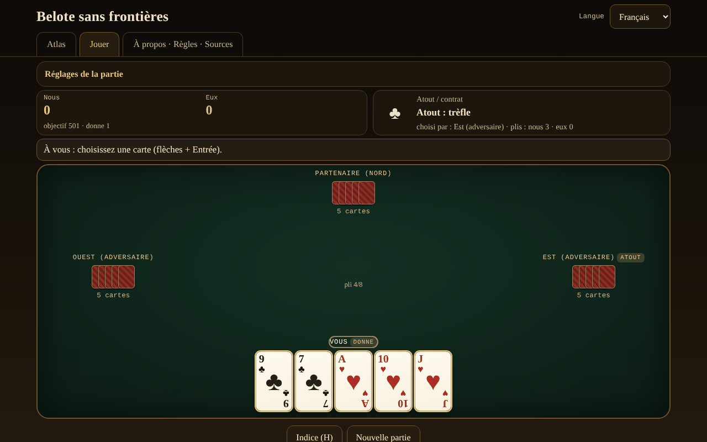

# Belot fără frontiere

[English](README.md) · [Română](README.ro.md) · **Français** · [Italiano](README.it.md) · [Español](README.es.md) · [Português](README.pt.md) · [Deutsch](README.de.md) · [Magyar](README.hu.md)

**Version :** 1.2.6 · **Dernière mise à jour :** 2026-10-23

Langues de l'interface : **Română, English, Français, Italiano, Español, Português (PT), Deutsch, Magyar**

Atlas et jeu contre une IA locale : le belot roumain et ses cousins (belote, contrée, bela, klaverjas, jass), dans un seul fichier HTML, hors ligne.

**Application en ligne :** https://chiuta.github.io/Belot-fara-frontiere/

## De quoi s'agit-il

Un atlas de la famille belote/bela/klaverjas/jass et un jeu : vous et un partenaire IA contre deux adversaires IA, à une table de 4 joueurs. La priorité 1 est le belot roumain (32 cartes, atout choisi en deux tours, annonces, obligation de fournir/couper/surcouper, capot, jeu jusqu'à 501/1001). Les autres variantes tournent sur le même moteur paramétré. Le tout est un seul `index.html` (~200 Ko), sans dépendances, sans polices ni images externes, sans compte, sans télémétrie. Les cartes sont dessinées en CSS.

## Fonctionnalités

Vérifié dans le code et dans les tests :

- **7 variantes jouables** (tableau ci-dessous) sur un moteur paramétré (enchères, obligations, décompte, annonces configurables) et **5 entrées réservées à l'atlas**.
- **Belot roumain** : valeurs d'atout V 20, 9 14, A 11, 10 10, R 4, D 3, 8/7 = 0 ; hors atout A 11, 10 10, R 4, D 3, V 2 ; atout en deux tours d'après la carte retournée (le donneur peut être forcé au tour 2, en option) ; annonces terță 20 / cincizeci 50 / sută 100 / careu (V 200, 9 150, A-10-R-D 100) / belot 20 ; dernier pli +10 (total 162) ; capot +90 ; règle « la jumătate »/chute documentée sur la fiche ; objectif 501 ou 1001.
- **Obligations** de fournir, couper et surcouper (sauf pour le partenaire qui gagne, là où la règle de la variante le permet) ; les cartes illégales sont estompées, et la tentative de les jouer affiche le motif.
- **Annonces** détectées automatiquement (recherche exhaustive du meilleur découpage en séquences et carrés), concours entre équipes (égalité = annulation en RO — en option rotation —, rotation dans les autres), l'équipe sans pli perd les annonces (le belot reste).
- **IA à 3 niveaux réels** : 0 aléatoire légal ; 1 heuristique (estimation de l'atout à partir de la main par simulations, comptage des atouts, jeu de partenaire) ; 2 recherche PIMC (simulations Monte-Carlo sur des « mondes » compatibles avec ce qu'elle a vu). L'IA **n'a pas accès aux mains cachées** (elle reçoit seulement la vue du joueur) ; exception : l'option explicite « Mode apprentissage », qui **vous montre** les mains — l'IA ne les utilise toujours pas.
- **Belot (R+D d'atout)** : au belot roumain, il ne s'annonce qu'à la deuxième carte (l'IA ne déduit rien de la première carte) ; dans les autres variantes, à la première, comme chez Pagat.
- **Suggestion** (H) : l'IA de niveau 2 vous propose une carte ou une enchère.
- **Feuille de score** : après la deuxième main, la fenêtre de résultat affiche le tableau de toutes les mains de la partie (points ajoutés → total), dans les 8 langues.
- **Mélange** avec `crypto.getRandomValues` et échantillonnage par rejet ; **graine optionnelle** (mulberry32) pour des donnes reproductibles.
- **Atlas** consultable, filtrable (jouables/atlas seulement, famille), avec des fiches : règles, différences régionales, approximations ⚠, sources.
- **Interface en 8 langues** (RO/EN/FR/IT/ES/PT/DE/HU), avec détection automatique et sélecteur. Les textes longs (fiches de l'atlas, section À propos) sont complets en roumain et en anglais ; en FR/IT/ES/PT/DE/HU, la version anglaise s'affiche avec une discrète note « texte en anglais ».
- **Accessibilité** : jeu complet au clavier (flèches + Entrée/Espace, H pour la suggestion), `aria-live` pour l'état du jeu, focus visible, cibles tactiles d'au moins 44 px, `prefers-reduced-motion`, mode de couleurs distinctes pour le daltonisme (♦ bleu, ♣ vert), pas de défilement horizontal à 390 px.
- Statistiques locales (parties jouées/gagnées) et préférences (langue, niveau, couleurs) dans `localStorage`, dans des blocs `try/catch` ; l'application fonctionne aussi sans eux.

## Variantes

| Nom | Jouable ? | ⚠ Approximations |
|---|---|---|
| Belot roumain | oui | ⚠ Il n'existe pas de règlement officiel : « la jumătate »/chute est le choix de l'auteur (chute ⇒ les adversaires prennent tout, le belot reste ; égalité = elle a tenu). Pas de « bile » (points exacts), pas d'échange du 7, pas de bizon. La carte retournée va toujours à celui qui choisit l'atout. Annonces (terță/cincizeci/sută/careu) seulement à la première carte ; le belot ne s'annonce qu'à la deuxième carte. Deux points contestés entre les sources sont des options dans « Configuration de la partie » : coupe obligatoire aussi sur le partenaire (belot.md) vs. exemption (Pagat ; exempté par défaut) et annonces égales annulées (belot.md ; par défaut) vs. premier en rotation (Pagat). |
| Belote classique (France) | oui | ⚠ L'égalité 81–81 n'applique pas le « litige » ; les points sont tenus exacts. |
| Belote contrée (Coinche) | oui | ⚠ Les annonces de séquence/carré sont désactivées par défaut (en option, avec les règles de la belote classique) ; pas de « sans atout/tout atout » ; capot chuté 500 (choix). |
| Bela (Croatie/Serbie) | oui | ⚠ Seulement le jeu de base à 6 cartes à 4 joueurs ; pas de « otvorena bela » ; points exacts au lieu de la feuille de score régionale. |
| Klaverjas Amsterdams | oui | ⚠ Enchères simplifiées (le premier qui ne passe pas choisit l'atout, le dernier est obligé) ; pas de « verzaakt », pas de décompte de tournoi. |
| Klaverjas Rotterdams | oui | ⚠ Mêmes approximations qu'Amsterdams. |
| Jass (Schieber, Suisse) | oui | ⚠ Cartes françaises au lieu de cartes suisses ; multiplicateurs de couleur (♠ ♦ ×2) et objectif 1500 choisis et documentés ; weis simplifié (une seule équipe marque ses weis ; le carré de 100 bat la séquence de 100 et l'égalité totale se règle par rotation — non confirmé dans une source) ; une-ufe avec 6 = 0 et As = 11 (autres tables : 6 = 11, As = 0) ; pas de Differenzler/Coiffeur. |
| Belot bulgare | atlas seulement | ⚠ Les contrats « sans atout »/« tout atout » ne sont pas dans le moteur. |
| Belot à deux / à trois | atlas seulement | ⚠ Le moteur est construit sur 4 joueurs en partenariat. |
| Baloot | atlas seulement | ⚠ Non implémenté. |
| Clobyosh / Klabberjass | atlas seulement | ⚠ Non implémenté. |
| Coiffeur (Jass) | atlas seulement | ⚠ N'a pas de table de contrats. |

## Mode d'emploi

1. Ouvrez `index.html` (ou la page en ligne). Dans l'onglet **Atlas**, vous lisez les fiches des variantes ; ⚠ signale les approximations.
2. Appuyez sur **▶ Jouer** sur une fiche ou passez à l'onglet **Jouer** et choisissez la variante dans « Configuration de la partie » (objectif, niveau de l'IA, annonces, graine, mode apprentissage, couleurs distinctes).
3. Le donneur tourne. Aux enchères, le panneau supérieur vous montre les choix : « Je prends » ou « Passe » (tour 1), puis une couleur ou « Passe » (tour 2) ; à la contrée, vous choisissez la couleur et la valeur, puis vous pouvez contrer/surcontrer ; au Jass, vous choisissez atout, obe-abe, une-ufe ou « Schieben ».
4. Pendant le jeu, les cartes dorées sont les cartes légales, les cartes estompées sont interdites. Cliquez, ou flèches et Entrée/Espace pour jouer. Si vous avez des annonces, cochez « Annonce » avant la première carte.
5. Appuyez sur **Suggestion (H)** pour un conseil de l'IA forte.
6. À la fin de la main apparaît le tableau des points ; **Main suivante** continue, et lorsque l'objectif est atteint, la partie se termine. **Nouvelle partie** réinitialise.
7. La langue se change depuis le sélecteur en haut à droite ; elle est mémorisée dans le navigateur.

## Confidentialité et réseau

- Pas de réseau : il n'y a ni `fetch`, ni `XMLHttpRequest`, ni `WebSocket`, ni ressource externe ; CSP `default-src 'none'` sans `connect-src` ; les scripts ne s'exécutent que sur la base des hachages sha256 calculés au build ; `style-src 'unsafe-inline'` est nécessaire pour les styles de la page.
- Pas de télémétrie, pas de compte, pas de cookies. Dans `localStorage` ne sont conservés que la langue, le niveau de l'IA, les couleurs distinctes, la variante et les statistiques locales.
- Les seuls liens externes sont ceux du coin de la page (Buy Me a Coffee), avec `rel="noopener"` ; ils ne s'ouvrent qu'au clic.

## Limites et avertissements

- Le belot n'a pas de règlement unique : les règles choisies ici sont documentées sur chaque fiche ; aux tables de Roumanie, elles diffèrent (bile, « la jumătate », bizon, échange du 7).
- Les règles ont été vérifiées à travers des pages publiques (Pagat, belot.md, belot.bg, Wikipédia) lues au moyen de résumés automatiques, et non dans des règlements imprimés ; les nuances régionales peuvent être mal résumées. Le terme « 24 » pour le capot n'a pas pu être vérifié dans une source et n'est pas utilisé.
- L'IA est honnête (elle ne voit pas les cartes cachées), mais n'est pas une experte : le niveau 2 est un bon joueur de table ; aux enchères, elle utilise de courtes simulations ; elle modélise les adversaires avec sa propre heuristique, et peut donc préférer attendre là où un humain tirerait les atouts.
- Ce n'est pas un jeu de hasard avec mise : pas d'argent, de prix ni de comptes.
- Licence MIT (voir plus bas).

## Sources

- Pagat.com : Belote, Coinche, Contrée, Bela, Belot, Klaverjassen, Schieber, Baloot — `https://www.pagat.com/jass/belote.html`, `/coinche.html`, `/contree.html`, `/bela.html`, `/belot.html`, `/klaverjassen.html`, `/schieber.html`, `/baloot.html`
- Belot.md : https://belot.md/reguli_new.php
- belot.bg : https://belot.bg/en/rules-belot/
- Wikipédia : https://ro.wikipedia.org/wiki/Belot · https://en.wikipedia.org/wiki/Belot · https://fr.wikipedia.org/wiki/Belote_contr%C3%A9e · https://hr.wikipedia.org/wiki/Belot · https://en.wikipedia.org/wiki/Klaverjas
- regles-du-jeu.net : https://www.regles-du-jeu.net/comment-compter-les-points-a-la-belote/

Différences régionales notées dans l'application : belot.md utilise les bile et les règles bizon/échange du 7 ; Pagat place le contrat de la belote à plus de 81 et traite 81–81 comme « litige » ; le capot chuté à la contrée vaut 500 ou 410 selon la source.

## Exécution en local

Téléchargez `index.html` et ouvrez-le dans le navigateur ; il fonctionne entièrement sans internet. Sans serveur, sans installation.

## Historique / Changelog

### 1.2.5 — 2026-10-22
- fff-kit 1.1.4 : cibles tactiles et taille de texte minimale

### 1.2.4 — 2026-10-22
- fff-kit 1.1.2 : PBKDF2 600 000 itérations, protection anti-clickjacking

### 1.2.3 — 2026-10-22

finitions mobile et accessibilité : texte d’au moins 12 px et cibles tactiles d’au moins 24 px. l’étiquette technique liste désormais les 8 langues de l’interface ; focus clavier visible sur chaque contrôle.

### 1.1.0 — 2026-10-14
- Sauvegarde et étiquetage des données (fff-kit).

### 1.0.0 — 12 octobre 2026
- La version et la date de dernière mise à jour sont affichées dans l'application (pied de page).

### 11.10.2026 (troisième mise à jour) — 11 octobre 2026
- Feuille de score de la partie dans la fenêtre de résultat (points ajoutés et total pour chaque main), dans les 7 langues.
- Le tableau de résultat de la main avait un en-tête de colonne vide (signalé par axe lorsque la fenêtre est ouverte) ; il a maintenant une étiquette (masquée visuellement).
- Espace libre sous le contenu, afin que le widget fixe « Soutenir » ne puisse plus couvrir les derniers boutons ; CSP : `connect-src 'none'`.

### 11.10.2026 (deuxième mise à jour) — 11 octobre 2026
- Les étiquettes courtes des cartes de l'atlas (p. ex. « 4 joueurs », « 32 cartes », « atout en 2 tours », « enchères ») s'affichaient en roumain dans toutes les langues ; elles sont désormais traduites dans les 7 langues de l'interface, et la recherche de l'atlas les trouve aussi dans la langue choisie.
- Mobile (≤620 px) : les onglets (Atlas, Jouer, À propos) tiennent sur une seule ligne, l'en-tête occupe moins de place.

### 11.10.2026 — 11 octobre 2026
- Accessibilité : titres de niveau 2 (masqués visuellement) pour chaque onglet, le bloc « Soutenir » comme région (aside) étiquetée ; vérification axe sans violation aux deux tailles.

## Licence

MIT — voir le fichier `LICENSE`.

## Auteur

Alexio — Alexandru-Ionuț Chiuță, alexio@trom.tf

## Résumé

Belot sans frontières est un atlas et jeu monofichier, hors ligne, de la famille belote : le belot roumain (priorité), la belote classique française, la belote contrée, la bela, le klaverjas (Amsterdam et Rotterdam) et le jass (Schieber) sont jouables contre une IA qui ne voit jamais les mains cachées ; cinq autres cousins sont réservés à l'atlas. Chaque approximation est signalée par ⚠. Interface en 8 langues (textes longs en roumain et en anglais seulement), jouable au clavier, option daltonisme, sans réseau, sans télémétrie, sans compte. Licence : non déclarée (décision de l'auteur).
