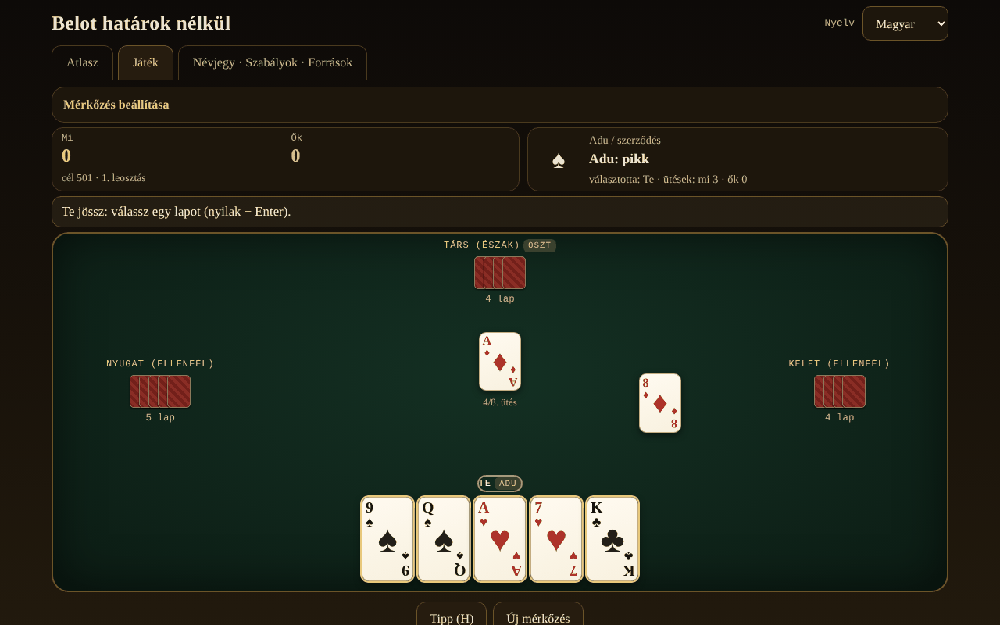

# Belot fără frontiere

[English](README.md) · [Română](README.ro.md) · [Français](README.fr.md) · [Italiano](README.it.md) · [Español](README.es.md) · [Português](README.pt.md) · [Deutsch](README.de.md) · **Magyar**

**Verzió:** 1.2.0 · **Utolsó frissítés:** 2026-10-19

A felület nyelvei: **Română, English, Français, Italiano, Español, Português (PT), Deutsch, Magyar**

Atlasz és játék helyi MI ellen: a román belot és rokonai (belote, contrée, bela, klaverjas, jass), egyetlen HTML-fájlban, offline.

**Online alkalmazás:** https://chiuta.github.io/Belot-fara-frontiere/

## Mi ez

A belote/bela/klaverjas/jass család atlasza és egy játék: te és egy MI-partner két MI-ellenfél ellen, 4 játékosos asztalnál. Az 1. prioritás a román belot (32 lap, adu két körben választva, bemondások, kötelező színre szolgálni/ütni/felülütni, capot, játék 501/1001 pontig). A többi változat ugyanazon a paraméterezett motoron fut. Az egész egyetlen `index.html` (~200 KB), függőségek nélkül, külső betűtípusok és képek nélkül, fiók nélkül, telemetria nélkül. A kártyák CSS-ben vannak megrajzolva.

## Funkciók

A kódban és a tesztekben ellenőrizve:

- **7 játszható változat** (lásd a lenti táblázatot) egy paraméterezett motoron (licitálás, kötelezettségek, pontozás, beállítható bemondások) és **5 csak atlaszban szereplő tétel**.
- **Román belot**: adu értékek J 20, 9 14, A 11, 10 10, K 4, Q 3, 8/7 = 0; nem adu A 11, 10 10, K 4, Q 3, J 2; adu két körben a felfordított lap után (az osztó a 2. körben kényszerülhet, opcionális); bemondások terță 20 / cincizeci 50 / sută 100 / careu (J 200, 9 150, A-10-K-Q 100) / belot 20; utolsó ütés +10 (összesen 162); capot +90; a „la jumătate”/bukás szabály dokumentálva a lapon; cél 501 vagy 1001.
- **Kötelezettségek**: színre szolgálás, ütés és felülütés (kivéve a nyerő partnert, ahol a változat szabálya megengedi); a szabálytalan lapok halványak, és a kijátszásukra tett kísérlet megmutatja az okot.
- **Bemondások** automatikusan felismerve (kimerítő keresés a sorozatokra és négyesekre való legjobb felosztásra), versengés a csapatok között (egyenlőség = törlés RO-ban — opcionálisan rotáció —, a többiben rotáció), az ütés nélküli csapat elveszíti a bemondásait (a belot marad).
- **MI 3 valódi szinttel**: 0 véletlenszerű szabályos; 1 heurisztikus (az adu becslése a kézből szimulációkkal, adu számolás, partnerjáték); 2 PIMC-keresés (Monte Carlo szimulációk a látottakkal összeegyeztethető „világokon”). Az MI-nek **nincs hozzáférése a rejtett kezekhez** (csak a játékos nézetét kapja); kivétel: a kifejezett „Tanulási mód” opció, amely **neked** megmutatja a kezeket — az MI ezeket ettől még nem használja.
- **Belot (adu K+Q)**: a román belotnál csak a második lapnál mondják be (az MI nem következtet semmire az első lapból); a többi változatnál az elsőnél, mint a Pagatnál.
- **Tipp** (H): a 2. szintű MI lapot vagy licitet javasol neked.
- **Pontozólap**: a második leosztás után az eredményablak megmutatja a meccs összes leosztásának táblázatát (hozzáadott pontok → összesen), a 8 nyelven.
- **Keverés** `crypto.getRandomValues`-szal és elutasításos mintavételezéssel; **opcionális mag** (mulberry32) reprodukálható leosztásokhoz.
- Kereshető, szűrhető **Atlasz** (játszható/csak atlasz, család), lapokkal: szabályok, regionális eltérések, ⚠ közelítések, források.
- **Felület 8 nyelven** (RO/EN/FR/IT/ES/PT/DE/HU), automatikus felismeréssel és választóval. A hosszú szövegek (az atlaszlapok, a Névjegy szakasz) románul és angolul teljesek; az FR/IT/ES/PT/DE/HU nyelveken az angol változat jelenik meg egy diszkrét „szöveg angolul” megjegyzéssel.
- **Akadálymentesség**: teljesen játszható billentyűzettel (nyilak + Enter/Szóköz, H a tipphez), `aria-live` a játékállapothoz, látható fókusz, legalább 44 px-es érintési célpontok, `prefers-reduced-motion`, megkülönböztethető színek módja a színvakság esetére (♦ kék, ♣ zöld), nincs vízszintes görgetés 390 px-en.
- Helyi statisztikák (lejátszott/megnyert meccsek) és beállítások (nyelv, szint, színek) a `localStorage`-ban, `try/catch` blokkokban; az alkalmazás ezek nélkül is működik.

## Változatok

| Név | Játszható? | ⚠ Közelítések |
|---|---|---|
| Román belot | igen | ⚠ Nincs hivatalos szabálykönyv: a „la jumătate”/bukás a szerző döntése (bukás ⇒ az ellenfelek mindent visznek, a belot marad; egyenlőség = tartotta). Nincsenek „bile” (pontos pontok), nincs a 7-es cseréje, nincs bizon. A felfordított lap mindig ahhoz kerül, aki az adut választja. A bemondások (terță/cincizeci/sută/careu) csak az első lapnál; a belot csak a második lapnál mondható be. Két, a források között vitatott pont opció a „Meccsbeállításokban”: kötelező ütés a partneren is (belot.md) vs. mentesítve (Pagat; alapértelmezetten mentesítve) és az egyenlő bemondások törlése (belot.md; alapértelmezett) vs. az első a rotációban (Pagat). |
| Klasszikus belote (Franciaország) | igen | ⚠ A 81–81-es egyenlőségnél nem érvényes a „litige”; a pontokat pontosan vezeti. |
| Belote contrée (Coinche) | igen | ⚠ A sorozat/négyes bemondások alapértelmezetten ki vannak kapcsolva (opcionális, a klasszikus belote szabályaival); nincs „sans atout/tout atout”; bukott capot 500 (választás). |
| Bela (Horvátország/Szerbia) | igen | ⚠ Csak az alapjáték 6 lappal 4 játékosra; nincs „otvorena bela”; pontos pontok a regionális pontozólap helyett. |
| Klaverjas Amsterdams | igen | ⚠ Egyszerűsített licitálás (az első, aki nem passzol, választja az adut, az utolsó kényszerítve van); nincs „verzaakt”, nincs versenypontozás. |
| Klaverjas Rotterdams | igen | ⚠ Ugyanazok a közelítések, mint az Amsterdamsnál. |
| Jass (Schieber, Svájc) | igen | ⚠ Francia lapok svájci lapok helyett; színszorzók (♠ ♦ ×2) és az 1500-as cél dokumentáltan választva; egyszerűsített weis (csak egy csapat pontozza a weis-eit; a 100-as négyes üti a 100-as sorozatot, a teljes egyenlőséget pedig rotáció dönti el — egy forrásban nem megerősített); une-ufe 6 = 0 és Ász = 11 értékkel (más asztalokon: 6 = 11, Ász = 0); nincs Differenzler/Coiffeur. |
| Bolgár belot | csak atlasz | ⚠ Az „adu nélkül”/„minden adu” szerződések nincsenek a motorban. |
| Belot kettesben / hármasban | csak atlasz | ⚠ A motor 4, párban játszó játékosra épül. |
| Baloot | csak atlasz | ⚠ Nincs megvalósítva. |
| Clobyosh / Klabberjass | csak atlasz | ⚠ Nincs megvalósítva. |
| Coiffeur (Jass) | csak atlasz | ⚠ Nincs szerződéstáblázata. |

## Használati útmutató

1. Nyisd meg az `index.html` fájlt (vagy az online oldalt). Az **Atlasz** lapon olvasod a változatok lapjait; a ⚠ jelöli a közelítéseket.
2. Nyomd meg a **▶ Játék** gombot egy lapon, vagy térj át a **Játék** lapra, és válaszd ki a változatot a „Meccsbeállításokban” (cél, MI-szint, bemondások, mag, tanulási mód, megkülönböztethető színek).
3. Az osztó forog. A licitálásnál a felső panel mutatja a választási lehetőségeket: „Viszem” vagy „Passz” (1. kör), majd egy szín vagy „Passz” (2. kör); a Contrée-nál kiválasztod a színt és az értéket, majd kontrázhatsz/rekontrázhatsz; a Jassnál adut, obe-abe-t, une-ufe-t vagy „Schieben”-t választasz.
4. A játék során az aranyszínű lapok a szabályosak, a halványak tiltottak. Kattints, vagy nyilak és Enter/Szóköz a játékhoz. Ha van bemondásod, az első lap előtt pipáld be a „Bemondás” jelölőnégyzetet.
5. Nyomd meg a **Tipp (H)** gombot az erős MI tanácsáért.
6. A leosztás végén megjelenik a pontok táblázata; a **Következő leosztás** folytatja, a cél elérésekor pedig a meccs véget ér. Az **Új meccs** visszaállít.
7. A nyelv a jobb felső sarokban lévő választóval módosítható; a böngésző megjegyzi.

## Adatvédelem és hálózat

- Nincs hálózat: nincs `fetch`, `XMLHttpRequest`, `WebSocket` vagy külső erőforrás; CSP `default-src 'none'` `connect-src` nélkül; a szkriptek csak a buildkor számolt sha256 hash-ek alapján futnak; az oldalon belüli stílusokhoz `style-src 'unsafe-inline'` szükséges.
- Nincs telemetria, nincs fiók, nincsenek sütik. A `localStorage` csak a nyelvet, az MI-szintet, a megkülönböztethető színeket, a változatot és a helyi statisztikákat őrzi.
- Az egyetlen külső hivatkozások az oldal sarkában találhatók (Buy Me a Coffee), `rel="noopener"` jelöléssel; csak kattintásra nyílnak meg.

## Korlátok és figyelmeztetések

- A belotnak nincs egységes szabálykönyve: az itt választott szabályok minden lapon dokumentálva vannak; romániai asztaloknál eltérnek (bile, „la jumătate”, bizon, a 7-es cseréje).
- A szabályokat nyilvános oldalakon keresztül ellenőriztem (Pagat, belot.md, belot.bg, Wikipedia), automatikus összefoglalókon át olvasva, nem nyomtatott szabálykönyvekből; a regionális árnyalatok rosszul lehetnek összefoglalva. A capot „24” kifejezése nem volt ellenőrizhető forrásban, és nincs használva.
- Az MI őszinte (nem látja a rejtett lapokat), de nem szakértő: a 2. szint jó asztali játékos; licitálásnál rövid szimulációkat használ; az ellenfeleket a saját heurisztikájával modellezi, így előfordulhat, hogy várakozni választ ott, ahol egy ember lehúzná az adukat.
- Nem téttel játszott szerencsejáték: nincs pénz, nyeremény vagy fiók.
- MIT licenc (lásd lejjebb).

## Források

- Pagat.com: Belote, Coinche, Contrée, Bela, Belot, Klaverjassen, Schieber, Baloot — `https://www.pagat.com/jass/belote.html`, `/coinche.html`, `/contree.html`, `/bela.html`, `/belot.html`, `/klaverjassen.html`, `/schieber.html`, `/baloot.html`
- Belot.md: https://belot.md/reguli_new.php
- belot.bg: https://belot.bg/en/rules-belot/
- Wikipedia: https://ro.wikipedia.org/wiki/Belot · https://en.wikipedia.org/wiki/Belot · https://fr.wikipedia.org/wiki/Belote_contr%C3%A9e · https://hr.wikipedia.org/wiki/Belot · https://en.wikipedia.org/wiki/Klaverjas
- regles-du-jeu.net: https://www.regles-du-jeu.net/comment-compter-les-points-a-la-belote/

Az alkalmazásban jelzett regionális eltérések: a belot.md bile-t és a bizon/7-es csere szabályait használja; a Pagat a belote szerződését 81 fölé teszi, és a 81–81-et „litige”-ként kezeli; a bukott capot a contrée-nál a forrástól függően 500 vagy 410.

## Futtatás helyben

Töltsd le az `index.html` fájlt, és nyisd meg a böngészőben; internet nélkül teljes mértékben működik. Szerver és telepítés nélkül.

## Előzmények / Changelog

### 1.1.0 — 2026-10-14
- Biztonsági mentés és adatcímkézés (fff-kit).

### 1.0.0 — 2026. október 12.
- A verzió és az utolsó frissítés dátuma megjelenik az alkalmazásban (lábléc).

### 2026.10.11. (harmadik frissítés) — 2026. október 11.
- A meccs pontozólapja az eredményablakban (leosztásonként a hozzáadott pontok és az összeg), a 7 nyelven.
- A leosztás eredménytáblázatának üres oszlopfejléce volt (az axe jelezte, amikor az ablak nyitva van); most van (vizuálisan rejtett) címkéje.
- Szabad hely a tartalom alatt, hogy a rögzített „Támogass” widget többé ne takarhassa el az utolsó gombokat; CSP: `connect-src 'none'`.

### 2026.10.11. (második frissítés) — 2026. október 11.
- Az atlaszkártyák rövid címkéi (pl. „4 játékos”, „32 lap”, „adu 2 körben”, „licitálás”) minden nyelven románul jelentek meg; most le vannak fordítva a felület 7 nyelvére, és az atlaszkeresés a választott nyelven is megtalálja őket.
- Mobil (≤620 px): a lapok (Atlasz, Játék, Névjegy) egyetlen sorba férnek, a fejléc kevesebb helyet foglal.

### 2026.10.11. — 2026. október 11.
- Akadálymentesség: 2. szintű (vizuálisan rejtett) címsorok minden laphoz, a „Támogass” blokk címkézett régióként (aside); axe-ellenőrzés hibák nélkül mindkét méretben.

## Licenc

MIT — lásd a `LICENSE` fájlt.

## Szerző

Alexio — Alexandru-Ionuț Chiuță, alexio@trom.tf

## Összefoglaló

A Belot határok nélkül egyetlen fájlból álló, offline atlasz és játék a belote családról: a román belot (prioritás), a klasszikus francia belote, a belote contrée, a bela, a klaverjas (Amszterdam és Rotterdam) és a jass (Schieber) játszható egy olyan MI ellen, amely sosem lát rejtett kezeket; további öt rokon csak az atlaszban szerepel. Minden közelítés ⚠ jelzéssel van ellátva. Felület 8 nyelven (a hosszú szövegek csak románul és angolul), billentyűzettel játszható, színvak opció, hálózat, telemetria és fiók nélkül. Licenc: nem deklarált (a szerző döntése).
