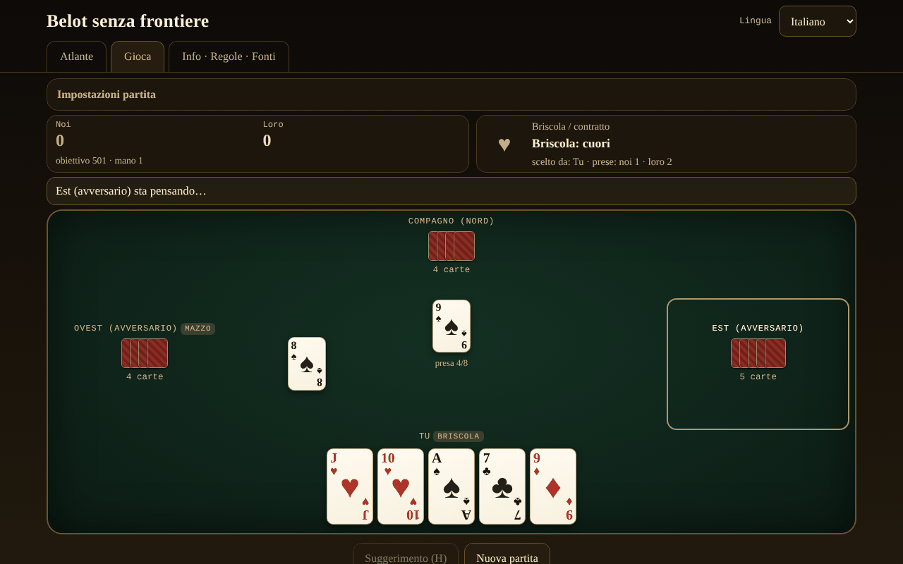

# Belot fără frontiere

[English](README.md) · [Română](README.ro.md) · [Français](README.fr.md) · **Italiano** · [Español](README.es.md) · [Português](README.pt.md) · [Deutsch](README.de.md) · [Magyar](README.hu.md)

**Versione:** 1.2.6 · **Ultimo aggiornamento:** 2026-10-23

Lingue dell'interfaccia: **Română, English, Français, Italiano, Español, Português (PT), Deutsch, Magyar**

Atlante e gioco contro un'IA locale: il belot rumeno e i suoi parenti (belote, contrée, bela, klaverjas, jass), in un unico file HTML, offline.

**Applicazione online:** https://chiuta.github.io/Belot-fara-frontiere/

## Che cos'è

Un atlante della famiglia belote/bela/klaverjas/jass e un gioco: tu e un compagno IA contro due avversari IA, a un tavolo da 4 giocatori. La priorità 1 è il belot rumeno (32 carte, briscola scelta in due giri, dichiarazioni, obbligo di rispondere/tagliare/sovrataglire, capot, gioco fino a 501/1001). Le altre varianti girano sullo stesso motore parametrizzato. Tutto è un unico `index.html` (~200 KB), senza dipendenze, senza font o immagini esterni, senza account, senza telemetria. Le carte sono disegnate in CSS.

## Funzionalità

Verificato nel codice e nei test:

- **7 varianti giocabili** (tabella sotto) su un motore parametrizzato (licitazione, obblighi, punteggio, dichiarazioni configurabili) e **5 voci solo atlante**.
- **Belot rumeno**: valori della briscola J 20, 9 14, A 11, 10 10, K 4, Q 3, 8/7 = 0; fuori briscola A 11, 10 10, K 4, Q 3, J 2; briscola in due giri dopo la carta girata (il mazziere può essere obbligato nel giro 2, facoltativo); dichiarazioni terță 20 / cincizeci 50 / sută 100 / careu (J 200, 9 150, A-10-K-Q 100) / belot 20; ultima presa +10 (totale 162); capot +90; regola «la jumătate»/caduta documentata nella scheda; obiettivo 501 o 1001.
- **Obblighi** di rispondere, tagliare e sovrataglire (eccetto per il compagno che vince, dove la regola della variante lo consente); le carte illegali sono attenuate e il tentativo di giocarle mostra il motivo.
- **Dichiarazioni** rilevate automaticamente (ricerca esaustiva della migliore suddivisione in sequenze e quaterne), confronto tra squadre (parità = annullamento in RO — facoltativamente rotazione —, rotazione nelle altre), la squadra senza prese perde le dichiarazioni (il belot resta).
- **IA a 3 livelli reali**: 0 casuale legale; 1 euristica (stima della briscola dalla mano tramite simulazioni, conteggio delle briscole, gioco da compagno); 2 ricerca PIMC (simulazioni Monte Carlo su «mondi» compatibili con ciò che ha visto). L'IA **non ha accesso alle mani nascoste** (riceve solo la vista del giocatore); eccezione: l'opzione esplicita «Modalità apprendimento», che **ti mostra** le mani — l'IA continua a non usarle.
- **Belot (K+Q di briscola)**: nel belot rumeno si dichiara solo alla seconda carta (l'IA non deduce nulla dalla prima carta); nelle altre varianti, alla prima, come da Pagat.
- **Suggerimento** (H): l'IA di livello 2 ti propone una carta o una licitazione.
- **Foglio punteggio**: dopo la seconda mano, la finestra del risultato mostra la tabella di tutte le mani della partita (punti aggiunti → totale), nelle 8 lingue.
- **Mescolamento** con `crypto.getRandomValues` e campionamento per rifiuto; **seme facoltativo** (mulberry32) per distribuzioni riproducibili.
- **Atlante** ricercabile, filtrabile (giocabili/solo atlante, famiglia), con schede: regole, differenze regionali, approssimazioni ⚠, fonti.
- **Interfaccia in 8 lingue** (RO/EN/FR/IT/ES/PT/DE/HU), con rilevamento automatico e selettore. I testi lunghi (le schede dell'atlante, la sezione Informazioni) sono completi in rumeno e inglese; in FR/IT/ES/PT/DE/HU viene mostrata la versione inglese con una discreta nota «testo in inglese».
- **Accessibilità**: gioco completo da tastiera (frecce + Invio/Spazio, H per il suggerimento), `aria-live` per lo stato del gioco, focus visibile, aree touch di almeno 44 px, `prefers-reduced-motion`, modalità a colori distinti per il daltonismo (♦ blu, ♣ verde), nessuno scorrimento orizzontale a 390 px.
- Statistiche locali (partite giocate/vinte) e preferenze (lingua, livello, colori) in `localStorage`, in blocchi `try/catch`; l'applicazione funziona anche senza.

## Varianti

| Nome | Giocabile? | ⚠ Approssimazioni |
|---|---|---|
| Belot rumeno | sì | ⚠ Non esiste un regolamento ufficiale: «la jumătate»/caduta è una scelta dell'autore (caduta ⇒ gli avversari prendono tutto, il belot resta; parità = ha tenuto). Niente «bile» (punti esatti), niente scambio del 7, niente bizon. La carta girata va sempre a chi sceglie la briscola. Le dichiarazioni (terță/cincizeci/sută/careu) solo alla prima carta; il belot si dichiara solo alla seconda carta. Due punti contesi tra le fonti sono opzioni in «Configurazione della partita»: taglio obbligatorio anche sul compagno (belot.md) vs. esonerato (Pagat; predefinito esonerato) e dichiarazioni uguali annullate (belot.md; predefinito) vs. il primo in rotazione (Pagat). |
| Belote classica (Francia) | sì | ⚠ La parità 81–81 non applica il «litige»; i punti sono tenuti esatti. |
| Belote contrée (Coinche) | sì | ⚠ Le dichiarazioni di sequenza/quaterna sono disattivate per impostazione predefinita (facoltative, con le regole della belote classica); niente «sans atout/tout atout»; capot caduto 500 (scelta). |
| Bela (Croazia/Serbia) | sì | ⚠ Solo il gioco di base con 6 carte a 4 giocatori; niente «otvorena bela»; punti esatti al posto del foglio punteggio regionale. |
| Klaverjas Amsterdams | sì | ⚠ Licitazione semplificata (il primo che non passa sceglie la briscola, l'ultimo è obbligato); niente «verzaakt», niente punteggio da torneo. |
| Klaverjas Rotterdams | sì | ⚠ Le stesse approssimazioni di Amsterdams. |
| Jass (Schieber, Svizzera) | sì | ⚠ Carte francesi al posto di quelle svizzere; moltiplicatori di seme (♠ ♦ ×2) e obiettivo 1500 scelti e documentati; weis semplificato (una sola squadra segna i propri weis; la quaterna da 100 batte la sequenza da 100 e la parità totale si risolve per rotazione — non confermato in una fonte); une-ufe con 6 = 0 e Asso = 11 (altri tavoli: 6 = 11, Asso = 0); niente Differenzler/Coiffeur. |
| Belot bulgaro | solo atlante | ⚠ I contratti «senza briscola»/«tutte briscole» non sono nel motore. |
| Belot in due / in tre | solo atlante | ⚠ Il motore è costruito su 4 giocatori in coppia. |
| Baloot | solo atlante | ⚠ Non implementato. |
| Clobyosh / Klabberjass | solo atlante | ⚠ Non implementato. |
| Coiffeur (Jass) | solo atlante | ⚠ Non ha la tabella dei contratti. |

## Guida all'uso

1. Apri `index.html` (o la pagina online). Nella scheda **Atlante** leggi le schede delle varianti; ⚠ segnala le approssimazioni.
2. Premi **▶ Gioca** su una scheda oppure passa alla scheda **Gioca** e scegli la variante in «Configurazione della partita» (obiettivo, livello IA, dichiarazioni, seme, modalità apprendimento, colori distinti).
3. Il mazziere ruota. Nella licitazione, il pannello superiore ti mostra le scelte: «Prendo» o «Passo» (giro 1), poi un seme o «Passo» (giro 2); alla Contrée scegli il seme e il valore, poi puoi dare contro/surcontro; al Jass scegli briscola, obe-abe, une-ufe o «Schieben».
4. Durante il gioco, le carte dorate sono quelle legali, quelle attenuate sono vietate. Clic, oppure frecce e Invio/Spazio per giocare. Se hai dichiarazioni, spunta «Dichiarazione» prima della prima carta.
5. Premi **Suggerimento (H)** per un consiglio dall'IA forte.
6. Alla fine della mano compare la tabella dei punti; **Mano successiva** prosegue e, raggiunto l'obiettivo, la partita termina. **Nuova partita** reimposta.
7. La lingua si cambia dal selettore in alto a destra; viene ricordata nel browser.

## Privacy e rete

- Nessuna rete: non ci sono `fetch`, `XMLHttpRequest`, `WebSocket` né risorse esterne; CSP `default-src 'none'` senza `connect-src`; gli script girano solo sulla base degli hash sha256 calcolati in fase di build; `style-src 'unsafe-inline'` è necessario per gli stili della pagina.
- Nessuna telemetria, nessun account, nessun cookie. In `localStorage` si conservano solo la lingua, il livello IA, i colori distinti, la variante e le statistiche locali.
- Gli unici link esterni sono quelli nell'angolo della pagina (Buy Me a Coffee), con `rel="noopener"`; si aprono solo al clic.

## Limiti e avvertenze

- Il belot non ha un regolamento unico: le regole scelte qui sono documentate in ogni scheda; ai tavoli in Romania differiscono (bile, «la jumătate», bizon, scambio del 7).
- Le regole sono state verificate tramite pagine pubbliche (Pagat, belot.md, belot.bg, Wikipedia) lette attraverso riassunti automatici, non da regolamenti stampati; le sfumature regionali possono essere riassunte in modo errato. Il termine «24» per il capot non ha potuto essere verificato in una fonte e non è usato.
- L'IA è onesta (non vede le carte nascoste), ma non è un'esperta: il livello 2 è un buon giocatore da tavolo; nella licitazione usa brevi simulazioni; modella gli avversari con la propria euristica, quindi può preferire attendere dove un umano toglierebbe le briscole.
- Non è un gioco d'azzardo con posta: niente denaro, premi o account.
- Licenza MIT (vedi sotto).

## Fonti

- Pagat.com: Belote, Coinche, Contrée, Bela, Belot, Klaverjassen, Schieber, Baloot — `https://www.pagat.com/jass/belote.html`, `/coinche.html`, `/contree.html`, `/bela.html`, `/belot.html`, `/klaverjassen.html`, `/schieber.html`, `/baloot.html`
- Belot.md: https://belot.md/reguli_new.php
- belot.bg: https://belot.bg/en/rules-belot/
- Wikipedia: https://ro.wikipedia.org/wiki/Belot · https://en.wikipedia.org/wiki/Belot · https://fr.wikipedia.org/wiki/Belote_contr%C3%A9e · https://hr.wikipedia.org/wiki/Belot · https://en.wikipedia.org/wiki/Klaverjas
- regles-du-jeu.net: https://www.regles-du-jeu.net/comment-compter-les-points-a-la-belote/

Differenze regionali annotate nell'applicazione: belot.md usa le bile e le regole bizon/scambio del 7; Pagat pone il contratto del belote a oltre 81 e tratta 81–81 come «litige»; il capot caduto alla contrée è 500 o 410 a seconda della fonte.

## Esecuzione in locale

Scarica `index.html` e aprilo nel browser; funziona completamente senza internet. Senza server, senza installazione.

## Cronologia / Changelog

### 1.2.5 — 2026-10-22
- fff-kit 1.1.4: target touch e dimensione minima del testo

### 1.2.4 — 2026-10-22
- fff-kit 1.1.2: PBKDF2 600.000 iterazioni, protezione anti-clickjacking

### 1.2.3 — 2026-10-22

rifiniture per mobile e accessibilità: testo di almeno 12 px e aree tattili di almeno 24 px. l’etichetta tecnica elenca ora tutte e 8 le lingue dell’interfaccia; focus da tastiera visibile su ogni controllo.

### 1.1.0 — 2026-10-14
- Copia di riserva ed etichettatura dei dati (fff-kit).

### 1.0.0 — 12 ottobre 2026
- La versione e la data dell'ultimo aggiornamento sono mostrate nell'applicazione (piè di pagina).

### 11.10.2026 (terzo aggiornamento) — 11 ottobre 2026
- Foglio punteggio della partita nella finestra del risultato (punti aggiunti e totale per ogni mano), nelle 7 lingue.
- La tabella del risultato della mano aveva un'intestazione di colonna vuota (segnalata da axe quando la finestra è aperta); ora ha un'etichetta (nascosta visivamente).
- Spazio libero sotto il contenuto, perché il widget fisso «Sostieni» non possa più coprire gli ultimi pulsanti; CSP: `connect-src 'none'`.

### 11.10.2026 (secondo aggiornamento) — 11 ottobre 2026
- Le etichette brevi sulle schede dell'atlante (ad es. «4 giocatori», «32 carte», «briscola in 2 giri», «licitazione») venivano mostrate in rumeno in ogni lingua; ora sono tradotte nelle 7 lingue dell'interfaccia, e la ricerca nell'atlante le trova anche nella lingua scelta.
- Mobile (≤620 px): le schede (Atlante, Gioca, Informazioni) stanno su un'unica riga, l'intestazione occupa meno spazio.

### 11.10.2026 — 11 ottobre 2026
- Accessibilità: titoli di livello 2 (nascosti visivamente) per ogni scheda, il blocco «Sostieni» come regione (aside) etichettata; verifica axe senza violazioni a entrambe le dimensioni.

## Licenza

MIT — vedi il file `LICENSE`.

## Autore

Alexio — Alexandru-Ionuț Chiuță, alexio@trom.tf

## Riepilogo

Belot senza frontiere è un atlante e gioco in un unico file, offline, della famiglia belote: il belot rumeno (priorità), la belote classica francese, la belote contrée, la bela, il klaverjas (Amsterdam e Rotterdam) e il jass (Schieber) sono giocabili contro un'IA che non vede mai le mani nascoste; altri cinque parenti sono solo atlante. Ogni approssimazione è segnalata con ⚠. Interfaccia in 8 lingue (testi lunghi solo in rumeno e inglese), giocabile da tastiera, opzione per daltonici, nessuna rete, nessuna telemetria, nessun account. Licenza: non dichiarata (decisione dell'autore).
