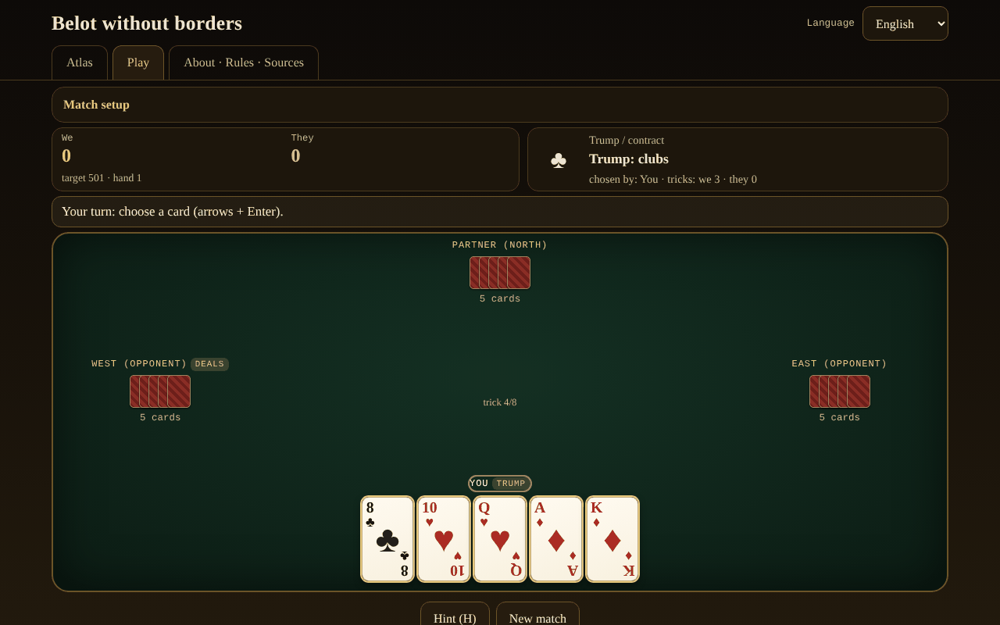

# Belot fără frontiere

**English** · [Română](README.ro.md) · [Français](README.fr.md) · [Italiano](README.it.md) · [Español](README.es.md) · [Português](README.pt.md) · [Deutsch](README.de.md) · [Magyar](README.hu.md)

**Version:** 2.2.0 · **Last updated:** 2026-10-27

**Status:** stable; review 2026-10-27 applied (see CHANGELOG.md); unified local multiplayer is **planned**, not yet implemented · **Offline:** complete (no network requests)

Interface languages: **Română, English, Français, Italiano, Español, Português (PT), Deutsch, Magyar**

An atlas and a game against a local AI: Romanian belot and its relatives (belote, contrée, bela, klaverjas, jass), in a single HTML file, offline.

**Live app:** https://chiuta.github.io/Belot-fara-frontiere/

## What it is

An atlas of the belote/bela/klaverjas/jass family and a game: you and an AI partner against two AI opponents, at a table of 4 players. Priority 1 is Romanian belot (32 cards, trump chosen in two rounds, announcements, the obligation to follow suit / trump / over-trump, capot, play to 501/1001). The other variants run on the same parameterised engine. Everything is a single `index.html` (~200 KB), with no dependencies, no external fonts or images, no account, no telemetry. The cards are drawn in CSS.

## Features

Verified in the code and in tests:

- **7 playable variants** (table below) on a parameterised engine (bidding, obligations, scoring, configurable announcements) and **5 atlas-only entries**.
- **Romanian belot**: trump values J 20, 9 14, A 11, 10 10, K 4, Q 3, 8/7 = 0; non-trump A 11, 10 10, K 4, Q 3, J 2; trump in two rounds after the turned-up card (the dealer can be forced in round 2, optional); announcements terță 20 / cincizeci 50 / sută 100 / careu (J 200, 9 150, A-10-K-Q 100) / belot 20; last trick +10 (total 162); capot +90; the "la jumătate"/fall rule documented on the sheet; target 501 or 1001.
- **Obligations** to follow suit, trump and over-trump (except for a winning partner, where the variant's rule allows it); illegal cards are dimmed, and trying to play them shows the reason.
- **Announcements** detected automatically (exhaustive search for the best split into sequences and four-of-a-kinds), contest between teams (tie = cancellation in RO — optionally rotation —, rotation in the others), the team with no tricks loses the announcements (the belot stays).
- **AI with 3 real levels**: 0 random legal; 1 heuristic (estimating the trump from the hand through simulations, trump counting, partner play); 2 PIMC search (Monte Carlo simulations on "worlds" compatible with what it has seen). The AI **has no access to the hidden hands** (it receives only the player's view); exception: the explicit "Learning mode" option, which **shows you** the hands — the AI still does not use them.
  **Checked by simulation** (`tests/niveluri-sim.test.mjs`, Romanian rules, 240 hands per pairing, seats alternated, results of 2026-10-27): level 2 beats level 0 by 171–67 (z = 6.7), level 1 beats level 0 by 163–74 (z = 5.8); level 2 beats level 1 by 139–100 (mean margin +22 points/hand, z = 2.5, barely at the edge of significance — the gap between 1 and 2 is real but small).
- **Belot (K+Q of trump)**: in Romanian belot it is announced only at the second card (the AI deduces nothing from the first card); in the other variants, at the first, as at Pagat.
- **Hint** (H): the level-2 AI suggests a card or a bid.
- **Score sheet**: after the second hand, the result window shows the table of all hands of the match (points added → total), in the 8 languages.
- **Shuffling** with `crypto.getRandomValues` and rejection sampling; **optional seed** (mulberry32) for reproducible deals.
- A searchable, filterable **Atlas** (playable/atlas-only, family), with sheets: rules, regional differences, ⚠ approximations, sources.
- **Interface in 8 languages** (RO/EN/FR/IT/ES/PT/DE/HU), with auto-detection and a selector. The long texts (the atlas sheets, the About section) are complete in Romanian and English; in FR/IT/ES/PT/DE/HU the English version is displayed with a discreet "text in English" note.
- **Accessibility**: fully keyboard-playable (arrows + Enter/Space, H for a hint), `aria-live` for the game state, visible focus, touch targets of at least 44 px, `prefers-reduced-motion`, a distinct-colours mode for colour blindness (♦ blue, ♣ green), no horizontal scroll at 390 px.
- Local statistics (matches played/won) and preferences (language, level, colours) in `localStorage`, in `try/catch` blocks; the app also works without them.

## Variants

| Name | Playable? | ⚠ Approximations |
|---|---|---|
| Romanian belot | yes | ⚠ There is no official rulebook: "la jumătate"/fall is the author's choice (a fall ⇒ the opponents take everything, the belot stays; a tie = it held). No "bile" (exact points), no 7 exchange, no bizon. The turned-up card always goes to the one who chooses the trump. Announcements (terță/cincizeci/sută/careu) only at the first card; the belot is announced only at the second card. Two points disputed between sources are options in "Match setup": mandatory trumping also over the partner (belot.md) vs. exempt (Pagat; default exempt) and equal announcements cancelled (belot.md; default) vs. first in rotation (Pagat). |
| Classic belote (France) | yes | ⚠ The 81–81 tie does not apply "litige"; points are kept exact. |
| Belote contrée (Coinche) | yes | ⚠ Sequence/four-of-a-kind announcements are disabled by default (optional, with the rules of classic belote); no "sans atout/tout atout"; capot fallen 500 (choice). |
| Bela (Croatia/Serbia) | yes | ⚠ Only the basic game with 6 cards at 4 players; no "otvorena bela"; exact points instead of the regional score sheet. |
| Klaverjas Amsterdams | yes | ⚠ Simplified bidding (the first who does not pass chooses the trump, the last is forced); no "verzaakt", no tournament scoring. |
| Klaverjas Rotterdams | yes | ⚠ The same approximations as Amsterdams. |
| Jass (Schieber, Switzerland) | yes | ⚠ French cards instead of Swiss cards; suit multipliers (♠ ♦ ×2) and target 1500 chosen and documented; simplified weis (only one team scores its weis; the four-of-a-kind of 100 beats the sequence of 100 and a total tie goes by rotation — unconfirmed in a source); une-ufe with 6 = 0 and Ace = 11 (other tables: 6 = 11, Ace = 0); no Differenzler/Coiffeur. |
| Bulgarian belot | atlas only | ⚠ The "no trump"/"all trump" contracts are not in the engine. |
| Belot for two / for three | atlas only | ⚠ The engine is built on 4 players in partnership. |
| Baloot | atlas only | ⚠ Not implemented. |
| Clobyosh / Klabberjass | atlas only | ⚠ Not implemented. |
| Coiffeur (Jass) | atlas only | ⚠ It has no contract table. |

## User guide

1. Open `index.html` (or the Live page). In the **Atlas** tab you read the variant sheets; ⚠ marks the approximations.
2. Press **▶ Play** on a sheet or go to the **Play** tab and choose the variant in "Match setup" (target, AI level, announcements, seed, learning mode, distinct colours).
3. The dealer rotates. In the bidding, the top panel shows you the choices: "Take" or "Pass" (round 1), then a suit or "Pass" (round 2); at Contrée you choose the suit and the value, then you can double/redouble; at Jass you choose trump, obe-abe, une-ufe or "Schieben".
4. In play, the golden cards are the legal ones, the dimmed ones are forbidden. Click, or arrows and Enter/Space to play. If you have announcements, tick "Announce" before the first card.
5. Press **Hint (H)** for advice from the strong AI.
6. At the end of the hand the points table appears; **Next hand** continues, and when the target is reached the match ends. **New match** resets.
7. The language is changed from the selector at the top right; it is remembered in the browser.

## Privacy and network

- No network: there is no `fetch`, `XMLHttpRequest`, `WebSocket` or external resource; CSP `default-src 'none'` without `connect-src`; scripts run only on the basis of the sha256 hashes computed at build; `style-src 'unsafe-inline'` is necessary for the in-page styles.
- No telemetry, no account, no cookies. `localStorage` keeps only the language, the AI level, the distinct colours, the variant and the local statistics.
- The only external links are those in the corner of the page (Buy Me a Coffee), with `rel="noopener"`; they open only on click.

## Limits and warnings

- Belot has no single rulebook: the rules chosen here are documented on each sheet; at tables in Romania they differ (bile, "la jumătate", bizon, the 7 exchange).
- The rules were checked through public pages (Pagat, belot.md, belot.bg, Wikipedia) read through automatic summaries, not from printed rulebooks; regional nuances may be summarised wrongly. The term "24" for capot could not be verified in a source and is not used.
- The AI is honest (it does not see the hidden cards) but is not an expert: level 2 is a good table player; in bidding it uses short simulations; it models the opponents with its own heuristic, so it may prefer to wait where a human would pull the trumps.
- It is not a game of chance with a stake: no money, prizes or accounts.
- MIT License (see below).

## Sources

- Pagat.com: Belote, Coinche, Contrée, Bela, Belot, Klaverjassen, Schieber, Baloot — `https://www.pagat.com/jass/belote.html`, `/coinche.html`, `/contree.html`, `/bela.html`, `/belot.html`, `/klaverjassen.html`, `/schieber.html`, `/baloot.html`
- Belot.md: https://belot.md/reguli_new.php
- belot.bg: https://belot.bg/en/rules-belot/
- Wikipedia: https://ro.wikipedia.org/wiki/Belot · https://en.wikipedia.org/wiki/Belot · https://fr.wikipedia.org/wiki/Belote_contr%C3%A9e · https://hr.wikipedia.org/wiki/Belot · https://en.wikipedia.org/wiki/Klaverjas
- regles-du-jeu.net: https://www.regles-du-jeu.net/comment-compter-les-points-a-la-belote/

Regional differences noted in the app: belot.md uses bile and the bizon/7 exchange rules; Pagat sets the belote contract at over 81 and treats 81–81 as "litige"; the fallen capot at contrée is 500 or 410 depending on the source.

## Running locally

Download `index.html` and open it in the browser; it works fully without internet. No server, no installation.

## History / Changelog

### 1.2.5 — 2026-10-22
- fff-kit 1.1.4: touch targets and minimum text size

### 1.2.4 — 2026-10-22
- fff-kit 1.1.2: PBKDF2 600,000 iterations, anti-clickjacking protection

### 1.2.3 — 2026-10-22

mobile and accessibility polish: text at least 12 px and touch targets at least 24 px. the technical label now lists all 8 interface languages; visible keyboard focus on every control.

### 1.1.0 — 2026-10-14
- Backup and data labelling (fff-kit).

### 1.0.0 — 12 October 2026
- The version and the date of the last update are shown in the app (footer).

### 11.10.2026 (third update) — 11 October 2026
- The match score sheet in the result window (points added and total for each hand), in the 7 languages.
- The hand result table had an empty column header (flagged by axe when the window is open); it now has a (visually hidden) label.
- Free space below the content, so that the fixed "Support" widget can no longer cover the last buttons; CSP: `connect-src 'none'`.

### 11.10.2026 (second update) — 11 October 2026
- The short labels on the atlas cards (e.g. "4 players", "32 cards", "trump in 2 rounds", "bidding") were displayed in Romanian in every language; they are now translated into the 7 interface languages, and the atlas search finds them in the chosen language too.
- Mobile (≤620 px): the tabs (Atlas, Play, About) fit on a single row, the header takes up less space.

### 11.10.2026 — 11 October 2026
- Accessibility: level-2 headings (visually hidden) for each tab, the "Support" block as a labelled region (aside); axe check with no violations at both sizes.

## License

MIT — see the `LICENSE` file.

## Author

Alexio — Alexandru-Ionuț Chiuță, alexio@trom.tf

## Summary

Belot without borders is a single-file, offline atlas and game of the belote family: Romanian Belot (priority), classic French Belote, Belote contrée, Bela, Klaverjas (Amsterdam and Rotterdam) and Jass (Schieber) are playable against an AI that never sees hidden hands; five more relatives are atlas-only. Every approximation is flagged with ⚠. UI in 8 languages (long texts in Romanian and English only), keyboard-playable, colour-blind option, no network, no telemetry, no account. Licence: undeclared (the author's decision).
