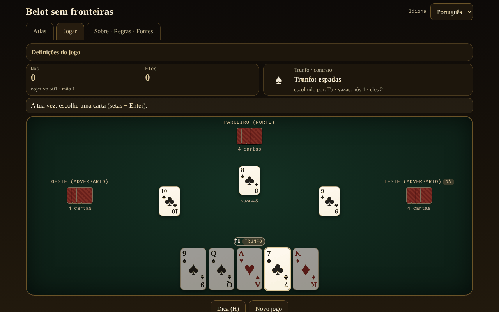

# Belot fără frontiere

[English](README.md) · [Română](README.ro.md) · [Français](README.fr.md) · [Italiano](README.it.md) · [Español](README.es.md) · **Português** · [Deutsch](README.de.md) · [Magyar](README.hu.md)

**Versão:** 1.2.1 · **Última atualização:** 2026-10-19

Idiomas da interface: **Română, English, Français, Italiano, Español, Português (PT), Deutsch, Magyar**

Atlas e jogo contra uma IA local: o belot romeno e os seus parentes (belote, contrée, bela, klaverjas, jass), num único ficheiro HTML, offline.

**Aplicação online:** https://chiuta.github.io/Belot-fara-frontiere/

## O que é

Um atlas da família belote/bela/klaverjas/jass e um jogo: você e um parceiro IA contra dois adversários IA, numa mesa de 4 jogadores. A prioridade 1 é o belot romeno (32 cartas, trunfo escolhido em duas voltas, anúncios, obrigação de assistir/cortar/sobrecortar, capot, jogo até 501/1001). As restantes variantes correm no mesmo motor parametrizado. Tudo é um único `index.html` (~200 KB), sem dependências, sem tipos de letra nem imagens externos, sem conta, sem telemetria. As cartas são desenhadas em CSS.

## Funcionalidades

Verificado no código e nos testes:

- **7 variantes jogáveis** (tabela abaixo) num motor parametrizado (licitação, obrigações, pontuação, anúncios configuráveis) e **5 entradas apenas de atlas**.
- **Belot romeno**: valores do trunfo J 20, 9 14, A 11, 10 10, K 4, Q 3, 8/7 = 0; fora de trunfo A 11, 10 10, K 4, Q 3, J 2; trunfo em duas voltas após a carta virada (o distribuidor pode ser obrigado na volta 2, opcional); anúncios terță 20 / cincizeci 50 / sută 100 / careu (J 200, 9 150, A-10-K-Q 100) / belot 20; última vaza +10 (total 162); capot +90; a regra «la jumătate»/queda documentada na ficha; objetivo 501 ou 1001.
- **Obrigações** de assistir, cortar e sobrecortar (exceto para o parceiro que ganha, onde a regra da variante o permite); as cartas ilegais ficam esbatidas, e a tentativa de as jogar mostra o motivo.
- **Anúncios** detetados automaticamente (pesquisa exaustiva da melhor divisão em sequências e quadras), disputa entre equipas (empate = anulação em RO — opcionalmente rotação —, rotação nas restantes), a equipa sem vazas perde os anúncios (o belot permanece).
- **IA com 3 níveis reais**: 0 aleatório legal; 1 heurístico (estimativa do trunfo a partir da mão por simulações, contagem de trunfos, jogo de parceiro); 2 pesquisa PIMC (simulações Monte Carlo sobre «mundos» compatíveis com o que viu). A IA **não tem acesso às mãos ocultas** (recebe apenas a vista do jogador); exceção: a opção explícita «Modo de aprendizagem», que **lhe mostra** as mãos — a IA continua a não as usar.
- **Belot (K+Q de trunfo)**: no belot romeno anuncia-se apenas com a segunda carta (a IA não deduz nada da primeira carta); nas restantes variantes, com a primeira, como no Pagat.
- **Sugestão** (H): a IA de nível 2 propõe-lhe uma carta ou uma licitação.
- **Folha de pontuação**: após a segunda mão, a janela de resultado mostra a tabela de todas as mãos do jogo (pontos acrescentados → total), nas 8 línguas.
- **Baralhamento** com `crypto.getRandomValues` e amostragem por rejeição; **semente opcional** (mulberry32) para distribuições reproduzíveis.
- **Atlas** pesquisável e filtrável (jogáveis/apenas atlas, família), com fichas: regras, diferenças regionais, aproximações ⚠, fontes.
- **Interface em 8 línguas** (RO/EN/FR/IT/ES/PT/DE/HU), com deteção automática e seletor. Os textos longos (as fichas do atlas, a secção Acerca) estão completos em romeno e inglês; em FR/IT/ES/PT/DE/HU é apresentada a versão inglesa com uma discreta nota «texto em inglês».
- **Acessibilidade**: jogo completo por teclado (setas + Enter/Espaço, H para a sugestão), `aria-live` para o estado do jogo, foco visível, alvos táteis de pelo menos 44 px, `prefers-reduced-motion`, modo de cores distintas para o daltonismo (♦ azul, ♣ verde), sem deslocamento horizontal a 390 px.
- Estatísticas locais (jogos disputados/ganhos) e preferências (língua, nível, cores) no `localStorage`, em blocos `try/catch`; a aplicação funciona também sem eles.

## Variantes

| Nome | Jogável? | ⚠ Aproximações |
|---|---|---|
| Belot romeno | sim | ⚠ Não existe um regulamento oficial: «la jumătate»/queda é uma escolha do autor (queda ⇒ os adversários levam tudo, o belot permanece; empate = aguentou). Sem «bile» (pontos exatos), sem troca do 7, sem bizon. A carta virada vai sempre para quem escolhe o trunfo. Os anúncios (terță/cincizeci/sută/careu) apenas com a primeira carta; o belot anuncia-se apenas com a segunda carta. Dois pontos disputados entre as fontes são opções em «Configuração do jogo»: corte obrigatório também sobre o parceiro (belot.md) vs. dispensado (Pagat; dispensado por predefinição) e anúncios iguais anulados (belot.md; por predefinição) vs. o primeiro em rotação (Pagat). |
| Belote clássica (França) | sim | ⚠ O empate 81–81 não aplica o «litige»; os pontos são mantidos exatos. |
| Belote contrée (Coinche) | sim | ⚠ Os anúncios de sequência/quadra estão desativados por predefinição (opcionais, com as regras da belote clássica); sem «sans atout/tout atout»; capot caído 500 (escolha). |
| Bela (Croácia/Sérvia) | sim | ⚠ Apenas o jogo básico com 6 cartas a 4 jogadores; sem «otvorena bela»; pontos exatos em vez da folha de pontuação regional. |
| Klaverjas Amsterdams | sim | ⚠ Licitação simplificada (o primeiro que não passa escolhe o trunfo, o último é obrigado); sem «verzaakt», sem pontuação de torneio. |
| Klaverjas Rotterdams | sim | ⚠ As mesmas aproximações do Amsterdams. |
| Jass (Schieber, Suíça) | sim | ⚠ Cartas francesas em vez de cartas suíças; multiplicadores de naipe (♠ ♦ ×2) e objetivo 1500 escolhidos e documentados; weis simplificado (apenas uma equipa pontua os seus weis; a quadra de 100 vence a sequência de 100 e o empate total resolve-se por rotação — não confirmado numa fonte); une-ufe com 6 = 0 e Ás = 11 (outras mesas: 6 = 11, Ás = 0); sem Differenzler/Coiffeur. |
| Belot búlgaro | apenas atlas | ⚠ Os contratos «sem trunfo»/«todos trunfo» não estão no motor. |
| Belot a dois / a três | apenas atlas | ⚠ O motor está construído sobre 4 jogadores em parceria. |
| Baloot | apenas atlas | ⚠ Não implementado. |
| Clobyosh / Klabberjass | apenas atlas | ⚠ Não implementado. |
| Coiffeur (Jass) | apenas atlas | ⚠ Não tem tabela de contratos. |

## Manual de utilização

1. Abra `index.html` (ou a página online). No separador **Atlas** lê as fichas das variantes; ⚠ assinala as aproximações.
2. Prima **▶ Jogar** numa ficha ou passe ao separador **Jogar** e escolha a variante em «Configuração do jogo» (objetivo, nível da IA, anúncios, semente, modo de aprendizagem, cores distintas).
3. O distribuidor roda. Na licitação, o painel superior mostra-lhe as escolhas: «Tomo» ou «Passo» (volta 1), depois um naipe ou «Passo» (volta 2); na Contrée escolhe o naipe e o valor, e depois pode contrar/recontrar; no Jass escolhe trunfo, obe-abe, une-ufe ou «Schieben».
4. No jogo, as cartas douradas são as legais, as esbatidas são proibidas. Clique, ou setas e Enter/Espaço para jogar. Se tiver anúncios, assinale «Anúncio» antes da primeira carta.
5. Prima **Sugestão (H)** para um conselho da IA forte.
6. No fim da mão aparece a tabela de pontos; **Mão seguinte** continua e, ao atingir o objetivo, o jogo termina. **Jogo novo** repõe.
7. A língua muda-se no seletor em cima à direita; fica guardada no navegador.

## Privacidade e rede

- Sem rede: não existem `fetch`, `XMLHttpRequest`, `WebSocket` nem recursos externos; CSP `default-src 'none'` sem `connect-src`; os scripts correm apenas com base nos hashes sha256 calculados na compilação; `style-src 'unsafe-inline'` é necessário para os estilos da página.
- Sem telemetria, sem conta, sem cookies. No `localStorage` guardam-se apenas a língua, o nível da IA, as cores distintas, a variante e as estatísticas locais.
- As únicas ligações externas são as do canto da página (Buy Me a Coffee), com `rel="noopener"`; abrem-se apenas ao clicar.

## Limites e avisos

- O belot não tem um regulamento único: as regras escolhidas aqui estão documentadas em cada ficha; nas mesas da Roménia diferem (bile, «la jumătate», bizon, troca do 7).
- As regras foram verificadas através de páginas públicas (Pagat, belot.md, belot.bg, Wikipédia) lidas por meio de resumos automáticos, não a partir de regulamentos impressos; as nuances regionais podem estar resumidas erradamente. O termo «24» para o capot não pôde ser verificado numa fonte e não é usado.
- A IA é honesta (não vê as cartas ocultas), mas não é uma especialista: o nível 2 é um bom jogador de mesa; na licitação usa simulações curtas; modela os adversários com a sua própria heurística, pelo que pode preferir esperar onde um humano tiraria os trunfos.
- Não é um jogo de azar com aposta: sem dinheiro, prémios ou contas.
- Licença MIT (veja abaixo).

## Fontes

- Pagat.com: Belote, Coinche, Contrée, Bela, Belot, Klaverjassen, Schieber, Baloot — `https://www.pagat.com/jass/belote.html`, `/coinche.html`, `/contree.html`, `/bela.html`, `/belot.html`, `/klaverjassen.html`, `/schieber.html`, `/baloot.html`
- Belot.md: https://belot.md/reguli_new.php
- belot.bg: https://belot.bg/en/rules-belot/
- Wikipédia: https://ro.wikipedia.org/wiki/Belot · https://en.wikipedia.org/wiki/Belot · https://fr.wikipedia.org/wiki/Belote_contr%C3%A9e · https://hr.wikipedia.org/wiki/Belot · https://en.wikipedia.org/wiki/Klaverjas
- regles-du-jeu.net: https://www.regles-du-jeu.net/comment-compter-les-points-a-la-belote/

Diferenças regionais assinaladas na aplicação: o belot.md usa bile e as regras bizon/troca do 7; o Pagat coloca o contrato da belote acima de 81 e trata 81–81 como «litige»; o capot caído na contrée é 500 ou 410 consoante a fonte.

## Execução local

Descarregue `index.html` e abra-o no navegador; funciona totalmente sem internet. Sem servidor, sem instalação.

## Histórico / Changelog

### 1.1.0 — 2026-10-14
- Cópia de segurança e etiquetagem de dados (fff-kit).

### 1.0.0 — 12 de outubro de 2026
- A versão e a data da última atualização são apresentadas na aplicação (rodapé).

### 11.10.2026 (terceira atualização) — 11 de outubro de 2026
- Folha de pontuação do jogo na janela de resultado (pontos acrescentados e total em cada mão), nas 7 línguas.
- A tabela de resultado da mão tinha um cabeçalho de coluna vazio (assinalado pelo axe com a janela aberta); agora tem uma etiqueta (oculta visualmente).
- Espaço livre sob o conteúdo, para que o widget fixo «Apoie» já não possa cobrir os últimos botões; CSP: `connect-src 'none'`.

### 11.10.2026 (segunda atualização) — 11 de outubro de 2026
- As etiquetas curtas dos cartões do atlas (p. ex. «4 jogadores», «32 cartas», «trunfo em 2 voltas», «licitação») eram apresentadas em romeno em qualquer língua; agora estão traduzidas nas 7 línguas da interface, e a pesquisa do atlas encontra-as também na língua escolhida.
- Telemóvel (≤620 px): os separadores (Atlas, Jogar, Acerca) cabem numa única linha, o cabeçalho ocupa menos espaço.

### 11.10.2026 — 11 de outubro de 2026
- Acessibilidade: títulos de nível 2 (ocultos visualmente) para cada separador, o bloco «Apoie» como região (aside) etiquetada; verificação axe sem violações em ambas as dimensões.

## Licença

MIT — veja o ficheiro `LICENSE`.

## Autor

Alexio — Alexandru-Ionuț Chiuță, alexio@trom.tf

## Resumo

Belot sem fronteiras é um atlas e jogo de ficheiro único, offline, da família belote: o belot romeno (prioridade), a belote clássica francesa, a belote contrée, a bela, o klaverjas (Amesterdão e Roterdão) e o jass (Schieber) são jogáveis contra uma IA que nunca vê as mãos ocultas; mais cinco parentes são apenas de atlas. Cada aproximação está assinalada com ⚠. Interface em 8 línguas (textos longos apenas em romeno e inglês), jogável por teclado, opção para daltónicos, sem rede, sem telemetria, sem conta. Licença: não declarada (decisão do autor).
