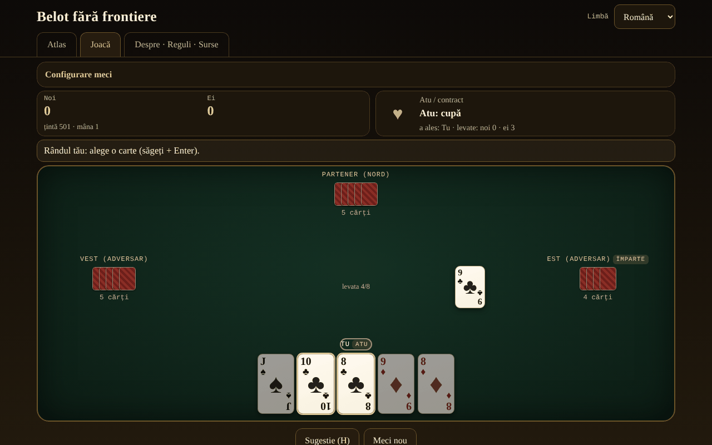

# Belot fără frontiere

[English](README.md) · **Română** · [Français](README.fr.md) · [Italiano](README.it.md) · [Español](README.es.md) · [Português](README.pt.md) · [Deutsch](README.de.md) · [Magyar](README.hu.md)

**Versiune:** 2.0.0 · **Ultima actualizare:** 2026-10-26

Limbile interfeței: **Română, English, Français, Italiano, Español, Português (PT), Deutsch, Magyar**

Atlas și joc contra AI local: belotul românesc și rudele lui (belote, contrée, bela, klaverjas, jass), într-un singur fișier HTML, offline.

**Live:** https://chiuta.github.io/Belot-fara-frontiere/

## Ce este

Un atlas al familiei belote/bela/klaverjas/jass și un joc: tu și un partener AI contra doi adversari AI, la masă de 4 jucători. Prioritatea 1 este belotul românesc (32 de cărți, atu ales în două ture, anunțuri, obligația de a servi/tăia/supra-tăia, capot, joc până la 501/1001). Celelalte variante rulează pe același motor parametrizat. Totul este un singur `index.html` (~200 KB), fără dependențe, fără fonturi sau imagini externe, fără cont, fără telemetrie. Cărțile sunt desenate în CSS.

## Funcții

Verificate în cod și în teste:

- **7 variante jucabile** (tabelul de mai jos) pe un motor parametrizat (licitație, obligații, punctare, anunțuri configurabile) și **5 intrări doar în atlas**.
- **Belot românesc**: valori atu J 20, 9 14, A 11, 10 10, K 4, Q 3, 8/7 = 0; non-atu A 11, 10 10, K 4, Q 3, J 2; atu în două ture după cartea întoarsă (dealerul poate fi obligat în tura 2, opțional); anunțuri terță 20 / cincizeci 50 / sută 100 / careu (J 200, 9 150, A-10-K-Q 100) / belot 20; ultima levată +10 (total 162); capot +90; regula „la jumătate”/cădere documentată pe fișă; țintă 501 sau 1001.
- **Obligații** de servit, tăiat și supra-tăiat (cu excepția partenerului care câștigă, unde regula variantei o permite), cărțile ilegale sunt estompate, iar încercarea de a le juca afișează motivul.
- **Anunțuri** detectate automat (căutare exhaustivă a celei mai bune împărțiri în secvențe și careuri), concurs între echipe (egalitate = anulare în RO — opțional rotație —, rotație în celelalte), echipa fără levate pierde anunțurile (belotul rămâne).
- **AI cu 3 niveluri reale**: 0 aleator legal; 1 euristic (estimarea atuului din mână prin simulări, numărarea atuurilor, joc de partener); 2 căutare PIMC (simulări Monte-Carlo pe „lumi” compatibile cu ce a văzut). AI-ul **nu are acces la mâinile ascunse** (primește doar vederea jucătorului); excepție: opțiunea explicită „Mod învățare” care **îți arată** mâinile, AI-ul tot nu le folosește.
- **Belot (K+Q de atu)**: la belotul românesc se anunță doar la a doua carte (AI-ul nu deduce nimic din prima carte); la celelalte variante, la prima, ca la Pagat.
- **Sugestie** (H): AI-ul de nivel 2 îți propune o carte sau o licitație.
- **Foaia de scor**: după a doua mână, fereastra de rezultat arată tabelul tuturor mâinilor meciului (puncte adăugate → total), în cele 8 limbi.
- **Amestecare** cu `crypto.getRandomValues` și eșantionare prin respingere; **seed opțional** (mulberry32) pentru împărțiri reproductibile.
- **Atlas** căutabil, filtrabil (jucabile/doar atlas, familie), cu fișe: reguli, diferențe regionale, ⚠ aproximări, surse.
- **Interfață în 8 limbi** (RO/EN/FR/IT/ES/PT/DE/HU), cu autodetecție și selector. Textele lungi (fișele din atlas, secțiunea Despre) sunt complete în română și engleză; în FR/IT/ES/PT/DE/HU se afișează varianta engleză cu o notă discretă „text în engleză”.
- **Accesibilitate**: joc complet de la tastatură (săgeți + Enter/Spațiu, H pentru sugestie), `aria-live` pentru starea jocului, focus vizibil, ținte tactile de cel puțin 44 px, `prefers-reduced-motion`, mod de culori distincte pentru daltonism (♦ albastru, ♣ verde), fără scroll orizontal la 390 px.
- **Masă în echipă (2.0.0)**: până la trei prieteni se pot alătura de pe telefoane diferite, direct (WebRTC, fără server, schimb manual de coduri sau QR). Gazda ține jocul și validează fiecare licitație și carte; oaspeții primesc doar propria mână (cărțile celorlalți nu pleacă niciodată din dispozitivul gazdei). Locurile libere rămân AI, iar dacă un oaspete iese, locul revine AI. Sugestia și modul învățare sunt oprite la masă.
- **Reluarea mâinii (2.0.0)**: după fiecare mână, buton „Reluare mână” cu distribuirea inițială și levată cu levată (cine a jucat ce, cine a câștigat, câte puncte, cărțile rămase). Funcționează și în jocul solo.
- Statistici locale (meciuri jucate/câștigate) și preferințe (limbă, nivel, culori) în `localStorage`, în blocuri `try/catch`; aplicația merge și fără ele.

## Variante

| Nume | Jucabil? | ⚠ Aproximări |
|---|---|---|
| Belot românesc | da | ⚠ Nu există regulament oficial: „la jumătate”/cădere este alegerea autorului (cade ⇒ adversarii iau tot, belotul rămâne; egalitate = a ținut). Fără bile (puncte exacte), fără schimbul de 7, fără bizon. Cartea întoarsă merge mereu la cel care alege atuul. Anunțurile (terță/cincizeci/sută/careu) doar la prima carte; belotul se anunță doar la a doua carte. Două puncte disputate între surse sunt opțiuni în „Configurare meci”: tăiat obligatoriu și peste partener (belot.md) vs. scutit (Pagat; implicit scutit) și anunțuri egale anulate (belot.md; implicit) vs. primul în rotație (Pagat). |
| Belote clasică (Franța) | da | ⚠ Egalitatea 81–81 nu aplică „litige”; punctele se țin exacte. |
| Belote contrée (Coinche) | da | ⚠ Anunțurile de secvență/careu sunt dezactivate implicit (opțional, cu regulile belotului clasic); fără „sans atout/tout atout”; capot căzut 500 (alegere). |
| Bela (Croația/Serbia) | da | ⚠ Doar jocul de bază cu 6 cărți la 4 jucători; fără „otvorena bela”; puncte exacte în loc de foaie de scor regională. |
| Klaverjas Amsterdams | da | ⚠ Licitație simplificată (primul care nu dă pas alege atuul, ultimul e obligat); fără „verzaakt”, fără scor de turneu. |
| Klaverjas Rotterdams | da | ⚠ Aceleași aproximări ca Amsterdams. |
| Jass (Schieber, Elveția) | da | ⚠ Cărți franceze în loc de cărți elvețiene; multiplicatori de culoare (♠ ♦ ×2) și țintă 1500 alese documentat; weis simplificat (o singură echipă își punctează weis-urile; careul de 100 bate secvența de 100 și egalitatea totală merge pe rotație — neconfirmat într-o sursă); une-ufe cu 6 = 0 și As = 11 (alte mese: 6 = 11, As = 0); fără Differenzler/Coiffeur. |
| Belot bulgar | doar atlas | ⚠ Contractele „fără atu”/„toate atu” nu sunt în motor. |
| Belot în doi / în trei | doar atlas | ⚠ Motorul este construit pe 4 jucători în parteneriat. |
| Baloot | doar atlas | ⚠ Nu este implementat. |
| Clobyosh / Klabberjass | doar atlas | ⚠ Nu este implementat. |
| Coiffeur (Jass) | doar atlas | ⚠ Nu are tabela de contracte. |

## Manual de utilizare

1. Deschide `index.html` (sau pagina Live). În fila **Atlas** citești fișele variantelor; ⚠ marchează aproximările.
2. Apasă **▶ Joacă** pe o fișă sau treci în fila **Joacă** și alege varianta din „Configurare meci” (țintă, nivel AI, anunțuri, seed, mod învățare, culori distincte).
3. Dealerul se rotește. În licitație, panoul de sus îți arată alegerile: „Iau” sau „Pas” (tura 1), apoi o culoare sau „Pas” (tura 2); la Contrée alegi culoarea și valoarea, apoi poți da contra/surcontra; la Jass alegi atu, obe-abe, une-ufe sau „Schieben”.
4. La joc, cărțile aurii sunt cele legale, cele estompate sunt interzise. Click, sau săgeți și Enter/Spațiu pentru a juca. Dacă ai anunțuri, bifezi „Anunț” înainte de prima carte.
5. Apasă **Sugestie (H)** pentru un sfat de la AI-ul puternic.
6. La sfârșitul mâinii apare tabelul de puncte; **Mâna următoare** continuă, iar la atingerea țintei meciul se încheie. **Meci nou** resetează.
7. Limba se schimbă din selectorul din dreapta sus; se reține în browser.

## Confidențialitate și rețea

- Fără rețea: nu există `fetch`, `XMLHttpRequest`, `WebSocket` sau resurse externe; CSP `default-src 'none'` fără `connect-src`; scripturile rulează doar pe baza hash-urilor sha256 calculate la build; `style-src 'unsafe-inline'` este necesar pentru stilurile din pagină.
- Masa în echipă folosește conexiuni WebRTC directe între dispozitive, pornite doar la cererea ta, după un avertisment (adresele IP se văd între parteneri); nu există server de mesaje.
- Fără telemetrie, fără cont, fără cookie-uri. În `localStorage` se păstrează doar limba, nivelul AI, culorile distincte, varianta și statisticile locale.
- Singurele linkuri externe sunt cele din colțul paginii (Buy Me a Coffee), cu `rel="noopener"`; se deschid doar la clic.

## Limite și avertismente

- Belotul nu are un regulament unic: regulile alese aici sunt documentate pe fiecare fișă; la mesele din România diferă (bile, „la jumătate”, bizon, schimbul de 7).
- Regulile au fost verificate prin pagini publice (Pagat, belot.md, belot.bg, Wikipedia) citite prin sumare automate, nu din regulamente tipărite; nuanțele regionale pot fi rezumate greșit. Termenul „24” pentru capot nu a putut fi verificat într-o sursă și nu este folosit.
- AI-ul este onest (nu vede cărțile ascunse), dar nu este un expert: nivelul 2 este un jucător bun de masă; la licitație folosește simulări scurte; modelează adversarii cu propria euristică, deci poate prefera să aștepte acolo unde un om ar trage atuul.
- Nu e un joc de noroc cu miză: fără bani, premii sau conturi.
- Licență MIT (vezi mai jos).

## Surse

- Pagat.com: Belote, Coinche, Contrée, Bela, Belot, Klaverjassen, Schieber, Baloot — `https://www.pagat.com/jass/belote.html`, `/coinche.html`, `/contree.html`, `/bela.html`, `/belot.html`, `/klaverjassen.html`, `/schieber.html`, `/baloot.html`
- Belot.md: https://belot.md/reguli_new.php
- belot.bg: https://belot.bg/en/rules-belot/
- Wikipedia: https://ro.wikipedia.org/wiki/Belot · https://en.wikipedia.org/wiki/Belot · https://fr.wikipedia.org/wiki/Belote_contr%C3%A9e · https://hr.wikipedia.org/wiki/Belot · https://en.wikipedia.org/wiki/Klaverjas
- regles-du-jeu.net: https://www.regles-du-jeu.net/comment-compter-les-points-a-la-belote/

Diferențe regionale notate în aplicație: belot.md folosește bile și regulile bizon/schimb de 7; Pagat pune contractul belote-ului la peste 81 și tratează 81–81 ca „litige”; capotul căzut la contrée este 500 sau 410 după sursă.

## Rulare locală

Descarcă `index.html` și deschide-l în browser; funcționează complet fără internet. Fără server, fără instalare.

## Istoric / Changelog

### 1.2.5 — 2026-10-22
- fff-kit 1.1.4: ținte tactile și text minim

### 1.2.4 — 2026-10-22
- fff-kit 1.1.2: PBKDF2 600 000 iterații, protecție anti-clickjacking

### 1.2.3 — 2026-10-22

finisaje pentru mobil și accesibilitate: text de cel puțin 12 px și ținte tactile de cel puțin 24 px. eticheta tehnică listează acum toate cele 8 limbi ale interfeței; focus de tastatură vizibil pe orice control.

### 1.1.0 — 2026-10-14
- Copie de rezervă și etichetare date (fff-kit).

### 1.0.0 — 12 octombrie 2026
- Versiunea și data ultimei actualizări sunt afișate în aplicație (subsol).

### 11.10.2026 (a treia actualizare) — 11 octombrie 2026
- Foaia de scor a meciului în fereastra de rezultat (puncte adăugate și total pe fiecare mână), în cele 7 limbi.
- Tabelul de rezultat al mâinii avea un antet de coloană gol (semnalat de axe când fereastra e deschisă); acum are etichetă (ascunsă vizual).
- Spațiu liber sub conținut, ca widgetul fix „Sprijină” să nu mai poată acoperi ultimele butoane; CSP: `connect-src 'none'`.

### 11.10.2026 (a doua actualizare) — 11 octombrie 2026
- Etichetele scurte de pe cardurile din atlas (de ex. „4 jucători”, „32 cărți”, „atu în 2 ture”, „licitație”) erau afișate în română în orice limbă; acum sunt traduse în cele 7 limbi ale interfeței, iar căutarea din atlas le găsește și în limba aleasă.
- Mobil (≤620 px): filele (Atlas, Joacă, Despre) încap pe un singur rând, antetul ocupă mai puțin loc.

### 11.10.2026 — 11 octombrie 2026
- Accesibilitate: titluri de nivel 2 (ascunse vizual) pentru fiecare filă, blocul „Sprijină” ca regiune (aside) etichetată; verificare axe fără încălcări în ambele dimensiuni.

## Licență

MIT — vezi fișierul `LICENSE`.

## Autor

Alexio — Alexandru-Ionuț Chiuță, alexio@trom.tf

## Rezumat

Belot fără frontiere este un atlas și joc offline într-un singur fișier al familiei belote: Belotul românesc (prioritar), Belote clasic francez, Belote contrée, Bela, Klaverjas (Amsterdam și Rotterdam) și Jass (Schieber) se pot juca împotriva unui AI care nu vede niciodată mâinile ascunse; alte cinci rude sunt doar în atlas. Fiecare aproximare este marcată cu ⚠. Interfață în 8 limbi (texte lungi doar în română și engleză), joc cu tastatura, opțiune pentru daltonism, fără rețea, fără telemetrie, fără cont. Licență: nedeclarată (decizia autorului).
